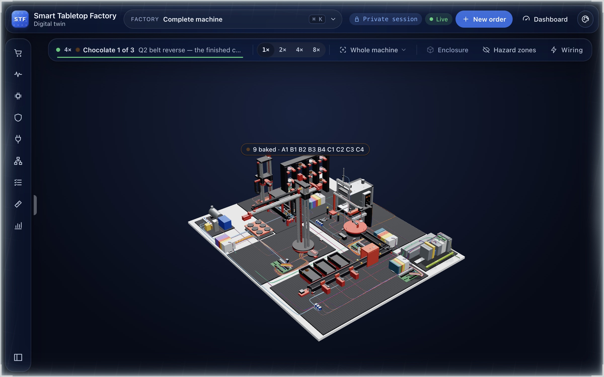
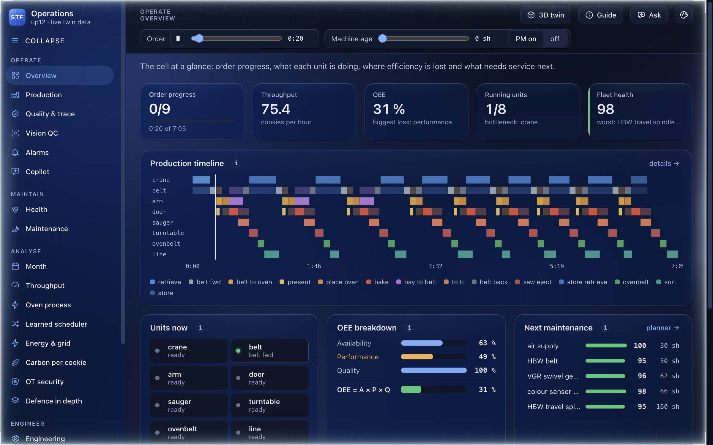
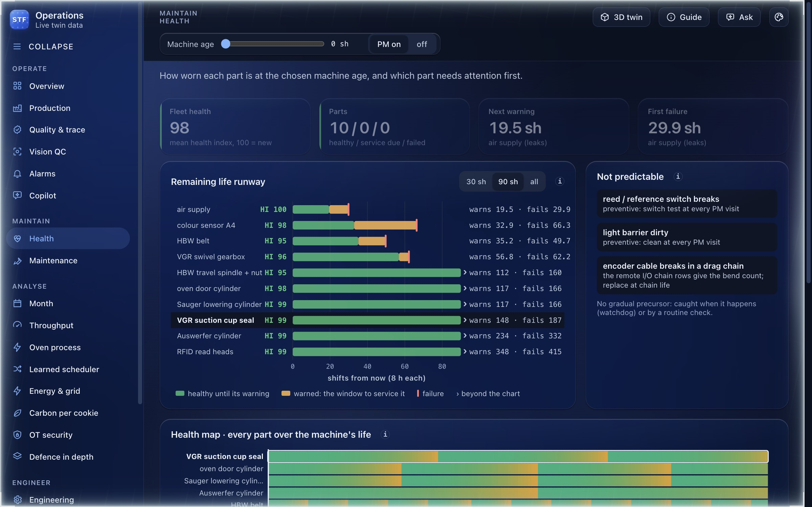
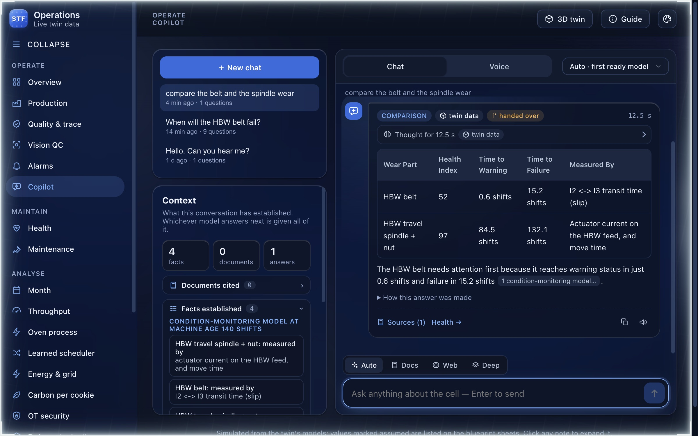
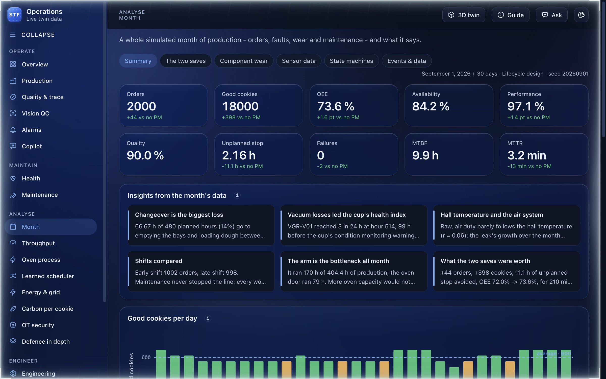
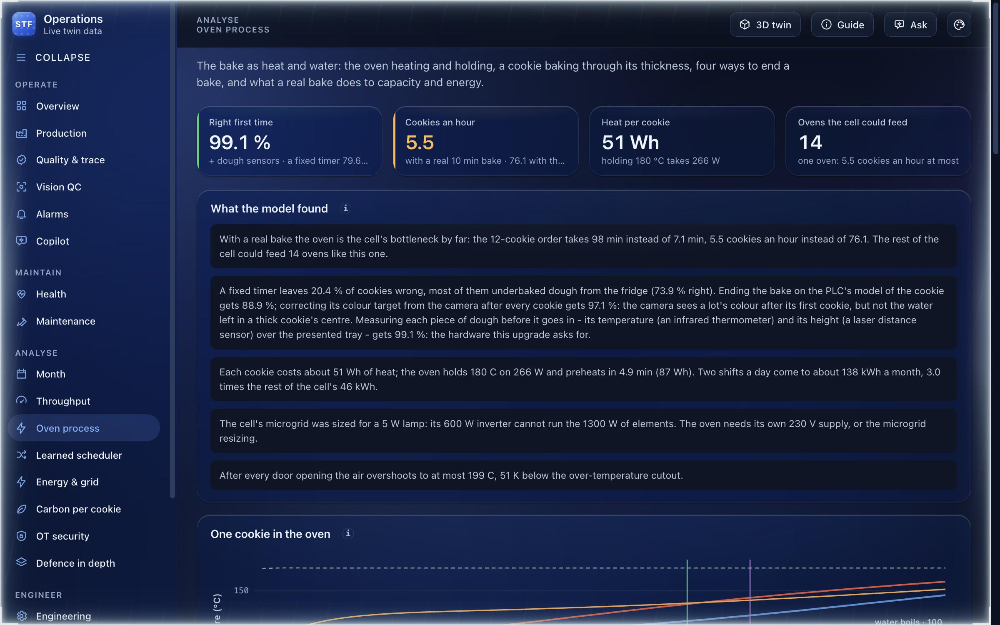
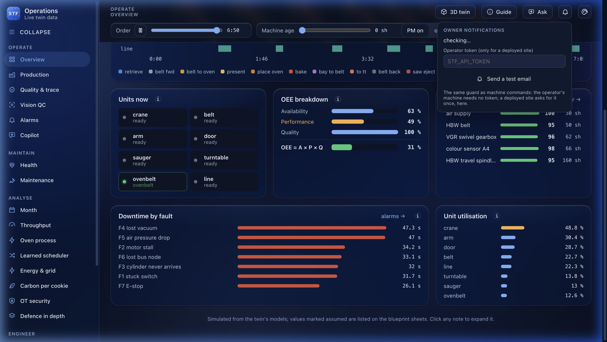
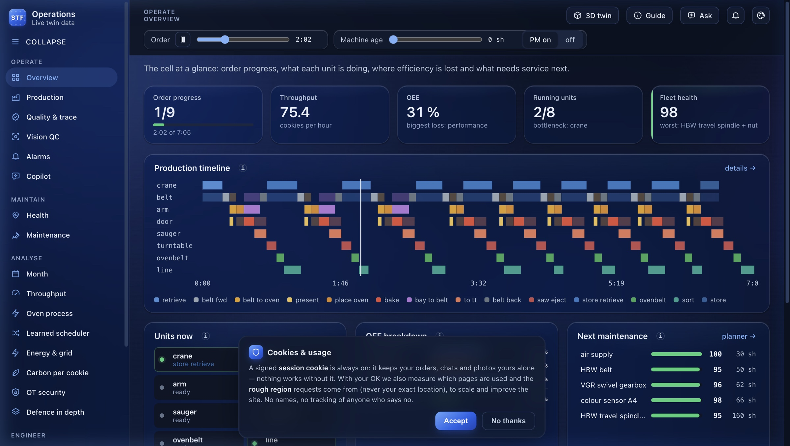
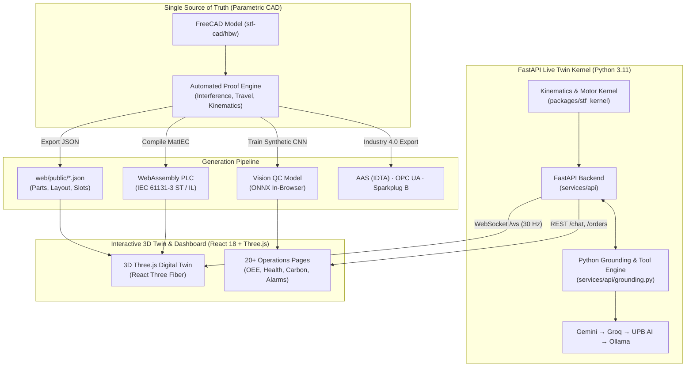

<p align="center">
  <a href="https://stf-live-500754517962.europe-west1.run.app/stf/">
    
  </a>
</p>

<p align="center">
  <h1 align="center">STF Digital Twin</h1>
  <p align="center">
    <strong>Full-Stack Cyber-Physical Digital Twin with In-Browser WebAssembly PLC & Grounded AI Copilot</strong>
  </p>
  <p align="center">
    <em>A mathematically proven digital twin of the fischertechnik Fabrik Simulation 24V (536634): 3D kinematics, real-time physics, IEC 61131-3 PLC control, predictive maintenance, and Industry 4.0 connectivity.</em>
  </p>
</p>

<p align="center">
  <a href="https://stf-live-500754517962.europe-west1.run.app/stf/">
    
  </a>
</p>

<p align="center">
  <a href="https://github.com/soham10i/stf-hw/actions/workflows/ci.yml"></a>
  <a href="https://stf-live-500754517962.europe-west1.run.app/stf/"></a>
  
  
  
  
  
  
</p>

<p align="center">
  <a href="https://stf-live-500754517962.europe-west1.run.app/stf/"><b>🚀 Live Production Twin + AI Copilot</b></a> •
  <a href="https://stf-twin.onrender.com/"><b>🌐 In-Browser Demo</b></a> •
  <a href="docs/DASHBOARD_GUIDE.md"><b>📖 Operations Guide</b></a> •
  <a href="docs/DEPLOY.md"><b>🚀 Deployment</b></a> •
  <a href="#quick-start"><b>💻 Quick Start</b></a>
</p>

---

### 🔬 Physical-to-Digital Pipeline (For Physical AI & Robotics Researchers)

| Core Question | System Architecture & Research Ground Truth |
| :--- | :--- |
| **What is the physical system?** | **Fischertechnik 24V Smart Training Factory / High-Bay Warehouse (Model 536634)** — an industrial cyber-physical automation testbed equipped with 24V bidirectional encoder motors, precision phototransistor light barriers, pneumatic vacuum suction grippers, and analog color sensors across 4 integrated workcells (High-Bay Warehouse, Multi-Processing Oven, Vacuum Gripper Robot, and Sorting Line with Vision QC). |
| **How does the data flow?** | **PLC / Microcontroller $\rightarrow$ MQTT / WebSockets $\rightarrow$ Live 3D State & Health Monitoring Twin** — Deterministic real-time sensor/actuator telemetry streams from physical field controllers over MQTT and bidirectional WebSockets directly into an in-browser 60 FPS Three.js physics & kinematics engine, an IEC 61131-3 WebAssembly execution runtime, and online predictive maintenance degradation estimators. |
| **Where is the live demo?** | **[https://stf-live-500754517962.europe-west1.run.app/stf/](https://stf-live-500754517962.europe-west1.run.app/stf/)** — Zero-install live cloud deployment featuring the full 3D interactive twin, physical factory simulation loop, WebAssembly PLC, multi-turn AI copilot, and all 20+ operations dashboards. |

---

<p align="center">
  
</p>

> [!NOTE]
> **One Parametric Model as the Single Source of Truth**: The CAD geometry, joint kinematics, electrical I/O, safety zones, analytics models, and the generated PLC code are derived from a unified FreeCAD parameter table. Nothing is exported unless mathematical and geometric proofs pass, guaranteeing zero drift between CAD, simulation, and physical execution.

---

## 📑 Table of Contents

- [Physical-to-Digital Pipeline](#-physical-to-digital-pipeline-for-physical-ai--robotics-researchers)
- [Key Highlights](#-key-highlights)
- [Visual Showcase](#-visual-showcase)
- [System Architecture](#-system-architecture)
- [Core Capabilities](#-core-capabilities)
  - [1. Real-Time 3D Kinematics & Physics](#1-real-time-3d-kinematics--physics)
  - [2. In-Browser IEC 61131-3 PLC (WebAssembly)](#2-in-browser-iec-61131-3-plc-webassembly)
  - [3. Grounded Industrial AI Copilot](#3-grounded-industrial-ai-copilot)
  - [4. Predictive Maintenance & Analytics Dashboard](#4-predictive-maintenance--analytics-dashboard)
  - [5. Industry 4.0 & Cyber-Physical Security](#5-industry-40--cyber-physical-security)
- [Quick Start](#-quick-start)
- [AI Copilot Setup (Cloud, Local & Offline)](#-ai-copilot-setup)
- [Repository Structure](#-repository-structure)
- [Testing & Validation](#-testing--validation)
- [Documentation Directory](#-documentation-directory)

---

## 🌟 Key Highlights

* **No Disconnected Mocks:** Real S-curve acceleration profiles, motor back-EMF, lead-screw pitches, and belt tooth meshing calculated per frame.
* **PLC in the Browser:** Production IEC 61131-3 Structured Text compiled by MatIEC to WebAssembly, running against a deterministic plant I/O loop.
* **Fact-Checked AI Copilot:** Multi-turn operations assistant with one fallback chain, the same locally and in production (Gemini → Groq → UPB AI → local Ollama → the twin's own tools). A rule-based router picks twin data, documents, web search or deep research and says why; the model's thinking streams in and folds away; mathematics renders as LaTeX; every number is checked against the evidence.
* **The Bake as a Process:** The oven is a thermal model built from its own CAD parts. Cookies dry and brown through their thickness, and four ways of ending a bake are compared on the same shifts: from 79.6 % right first time on a timer to 99.1 % with a soft sensor, the camera and two dough sensors.
* **Vision QC on the Process:** One cookie in every 12 is damaged on purpose (QC testing), and the camera's CNN catches it. The rejected cookie is held at the end of the line and made again.
* **One Dataset:** The month, energy, bake and inspection data the dashboard shows live in Supabase (SQLite locally); each visitor's twin adds its own orders and inspections.
* **20+ Dashboard Perspectives:** OEE waterfalls, cycle bottlenecks, carbon per batch, microgrid battery scheduling, vision QC, and ISO 13849 / IEC 62443 security boundaries.
* **Owner Notifications & Diagnostics:** Dedicated bell toolbar menu with live SMTP self-testing and throttled arrival alerts via Gmail or webhooks.
* **Privacy by Design:** Liquid glassmorphism UI with signed session isolation, zero canvas/fingerprint tracking, and consent-gated telemetry.
* **Dual Execution Modes:** Runs 100% serverless in the browser via static WebAssembly, or connects live via WebSockets (`/ws`) to a high-rate FastAPI simulation kernel.

---

## 📸 Visual Showcase

<table>
  <tr>
    <td width="50%">
      
      <br>
      <b>⚡ Real PLC Running in WebAssembly</b>
      <p>IEC 61131-3 control logic running directly in your browser. Shows real-time unit states, I/O registers, hazard zone interlocks, and the execution trace.</p>
    </td>
    <td width="50%">
      
      <br>
      <b>🔧 Physical Kinematics & Wire Routing</b>
      <p>Enclosure stripped away exposing real drag chains, lead screws, motor pulleys, photoelectric sensors, and field wiring to the PLC cabinet.</p>
    </td>
  </tr>
  <tr>
    <td width="50%">
      
      <br>
      <b>📊 Factory Operations & OEE</b>
      <p>Live order tracking, OEE breakdown (availability, performance, quality), dynamic cycle bottleneck analysis, and unit state progressions.</p>
    </td>
    <td width="50%">
      
      <br>
      <b>🩺 Predictive Maintenance & Degradation</b>
      <p>Health Index (HI) and Remaining Useful Life (RUL) tracking for high-bay warehouse belts, vacuum cups, oven heaters, and pneumatic seals.</p>
    </td>
  </tr>
  <tr>
    <td width="50%">
      
      <br>
      <b>🤖 Grounded Industrial Copilot</b>
      <p>Conversational assistant grounded in live telemetry and 438 technical documents. Verified against twin data before answers are presented.</p>
    </td>
    <td width="50%">
      
      <br>
      <b>📅 Full Simulated Production Month</b>
      <p>30 days of accelerated production: compare throughput, unexpected breakdowns, and downtime costs with preventive maintenance (PM) ON vs. OFF.</p>
    </td>
  </tr>
  <tr>
    <td width="50%">
      
      <br>
      <b>📷 Vision QC on the Process</b>
      <p>The camera in the colour hood photographs every cookie the twin bakes; the CNN and the autoencoder judge it, and one damaged cookie in every 12 tests them.</p>
    </td>
    <td width="50%">
      
      <br>
      <b>🔥 The Bake as a Process</b>
      <p>The oven heating, a cookie drying and browning through its thickness, four ways to end a bake, and what a real bake does to capacity and energy.</p>
    </td>
  </tr>
  <tr>
    <td width="50%">
      
      <br>
      <b>🔔 Real-Time Owner Notifications</b>
      <p>Instant alerts when visitors interact with the live factory twin. Includes live SMTP test triggers, per-guest throttling (max 1 email/12h), and token-guarded API delivery.</p>
    </td>
    <td width="50%">
      
      <br>
      <b>🛡️ Consent-Gated Privacy & Analytics</b>
      <p>Clean liquid glassmorphism design with strict privacy guarantees: zero canvas/fingerprint tracking, encrypted session isolation, and consent-gated telemetry stored in Supabase or SQLite.</p>
    </td>
  </tr>
</table>

---

## 🏗️ System Architecture



---

## ⚡ Core Capabilities

### 1. Real-Time 3D Kinematics & Physics
* **High-Bay Warehouse (HBW):** 3-axis Cartesian crane with automated slot management (4×3 rack), realistic rack indexing, and toothed belt kinematics.
* **Vacuum Gripper Robot (VGR):** Multi-axis articulated transfer arm with pneumatic suction cup simulation, pressure decay, and spring compliance.
* **Baking Oven & Turntable:** Synchronized sliding door, heating cycles, and turntable rotation.
* **Sorting Station:** Dual-belt sorting line with optical colour detection (white, red, blue) and pneumatic pusher gates.
* **Zero-Allocation Render Loop:** Three.js instanced rendering with in-place matrix updates to maintain rock-solid 60 FPS in standard browsers.

### 2. In-Browser IEC 61131-3 PLC (WebAssembly)
* **True Industrial Code:** The control logic is not simulated in JavaScript; it is written in IEC 61131-3 Structured Text.
* **Compiled to Wasm:** Using the MatIEC compiler toolchain, the logic compiles to WebAssembly and runs client-side against a full hardware I/O image.
* **Observable States:** Inspect digital/analog inputs, memory registers, fault flags, and safety interlocks in real time.

### 3. Grounded Industrial AI Copilot
* **Zero Hallucination Tolerance:** The copilot is grounded through a dedicated Python domain tool engine ([`services/api/grounding.py`](services/api/grounding.py)) accessing 11 live factory telemetry tools.
* **Automated Fact Verification:** The server cross-references numerical values in LLM outputs against underlying physical metrics before presenting them to the user.
* **One Fallback Chain** (`services/api/chat.py`, the same locally and in production):
  * **Gemini** first, then **Groq** (`openai/gpt-oss-120b`, which returns its reasoning), then **UPB AI** (the university's AI chat, a fixed credit), then a **local Ollama** model.
  * A provider that hits its limit, runs out of credit or times out is set aside for a while, so it costs one question, not every one.
  * When none can answer, the twin's tools answer, quoting the documents' passages (equations included).
* **Routed, not guessed** (`services/api/orchestrate.py`): rules decide whether a question needs the twin's data, the documents, a web search (Groq's browser search, every claim linked and graded trusted/unvetted) or deep research, and the answer shows the route and why.
* **Thinking and LaTeX:** the route, each step and the model's reasoning stream while it works and fold above the answer; mathematics renders with KaTeX, code in copyable blocks.
* **Voice:** ElevenLabs only listens and speaks (Scribe speech-to-text, voice 01 text-to-speech); it never writes an answer.
* **Context Preservation:** Chat sessions store established technical facts, allowing seamless hand-offs between models without losing context.

### 4. Predictive Maintenance & Analytics Dashboard
* **Condition Monitoring:** Real-time Health Index (HI) calculated via Exponentially Weighted Moving Averages (EWMA).
* **Remaining Useful Life (RUL):** Predicts wear runways on conveyor belts, vacuum seals, and mechanical drives.
* **Environmental & Financial Metrics:** Tracks carbon grams per cookie, dynamic electricity tariff scheduling, and microgrid renewable utilization.
* **Full Month Simulation:** Accelerated playback of 720 hours of production with controllable fault injection (motor jams, photo-sensor occlusion, air pressure loss), and QC testing: one damaged cookie in every 12, as in the twin.
* **The Bake as a Process (Upgrade 19):** oven heat-up, door losses, the cookie's water and colour, four ways to end a bake, capacity (5.5 cookies/h with a real 10-min bake) and energy (about 51 Wh per cookie) - [`docs/process/README.md`](docs/process/README.md).
* **The Mathematics, Written Down:** preventive maintenance ([`docs/maintenance/README.md`](docs/maintenance/README.md)) and the bake, every equation with the line that computes it; the papers behind them in [`papers/`](papers/README.md).

### 5. Industry 4.0 & Cyber-Physical Security
* **Asset Administration Shells (AAS):** IDTA-compliant submodels for Digital Nameplate, Handover Documentation, and Carbon Footprint.
* **OPC UA & MQTT:** OPC UA companion spec for Machinery and MQTT Sparkplug B mapped into an ISA-95 Unified Namespace (UNS).
* **OT Cybersecurity (IEC 62443):** Zone and conduit segmentation, operator role tokens, rate limiters, and defensive API origin validation.

---

## 💻 Quick Start

### Prerequisites
* **Python 3.11+**
* **Node.js 20+**
* *(Optional)* **Ollama** (for 100% private, offline LLM execution)

### 1. Clone & Setup

```bash
git clone https://github.com/soham10i/stf-hw.git
cd stf-hw

# Create virtualenv and install Python + Node dependencies
make install
```

### 2. Launch the Application

In two terminal windows:

```bash
# Terminal 1: Start the Python FastAPI backend (Port 8000)
make api
```

```bash
# Terminal 2: Start the Vite frontend dev server (Port 5173)
cd web && npm run dev
```

Open your browser:
* **Interactive 3D Twin:** [`http://localhost:5173/stf/`](http://localhost:5173/stf/)
* **Operations Dashboard:** [`http://localhost:5173/stf/dashboard.html`](http://localhost:5173/stf/dashboard.html)

---

## 🤖 AI Copilot Setup

The copilot works out-of-the-box in **Rules / Grounded Tool mode** without any external API keys. Every key you add joins the fallback chain, Gemini → Groq → UPB AI → local Ollama, in that order. Keys go in `.env` (git-ignored) locally, and in Render's environment in production; never in git.

```bash
cp .env.example .env
```

| Provider | `.env` | Notes |
|---|---|---|
| Gemini | `GEMINI_API_KEY`, `GEMINI_MODEL` | free tier: a daily quota per model |
| Groq | `GROQ_API_KEY` | `openai/gpt-oss-120b` first (returns its reasoning); also web search |
| UPB AI | `UPB_AI_KEY`, `UPB_AI_URL` | the university's AI chat: the last hosted fallback |
| Ollama (local) | `OLLAMA_URL`, `OLLAMA_MODEL` | `ollama run qwen2.5:7b-instruct`; detected automatically |
| ElevenLabs (voice only) | `ELEVENLABS_API_KEY`, `ELEVENLABS_VOICE_ID_01` | speech to text and text to speech; never writes answers |

Check which providers answer, in order, without printing a key:

```bash
make model-check
```

```bash
make voice-check
```

### The database

Guests, their conversations and photos, and the factory's data (the month, the energy month, the bakes, the camera's inspections) live in Supabase when `SUPABASE_URL` and `SUPABASE_SERVICE_KEY` are set, else in a local SQLite file ([`docs/DATABASE.md`](docs/DATABASE.md)). Load the factory's data from the simulations (`RESET=1` first forgets every guest, chat and photo):

```bash
make db-seed
```

---

## 📂 Repository Structure

```
stf-hw/
├── packages/
│   ├── stf_kernel/          # Physics engine: trajectories, S-curves, motor dynamics
│   └── stf_layout/          # Kinematic frame transforms and slot coordinate maps
├── services/
│   ├── api/                 # FastAPI REST & WebSocket server (ports, telemetry, copilot)
│   │   ├── chat.py          # LLM orchestration, verification, and session management
│   │   ├── grounding.py     # Deterministic domain tools & BM25 document search
│   │   └── runtime.py       # Async live factory simulation loop
│   └── sim/                 # Standalone simulation daemons & testing harnesses
├── stf-cad/
│   ├── hbw/                 # FreeCAD parametric model, collision proofs, and exporters
│   ├── hbw_model.py         # Parametric source of truth for all mechanical parts
│   └── sil/                 # MatIEC WebAssembly compiler for IEC 61131-3 logic
├── web/
│   ├── src/
│   │   ├── scene/           # Three.js / React Three Fiber 3D factory modules
│   │   ├── dashboard/       # 20+ operations dashboard views, charts, and guides
│   │   └── copilot/         # Chat client, audio/voice interface, and citation renderer
│   └── public/              # Exported CAD meshes, telemetry datasets, and knowledge bases
├── supabase/migrations/     # The database's tables: guests, documents, photos, the factory's data
├── papers/                  # The papers behind the algorithms (open-access PDFs, read locally)
└── docs/                    # Architecture reports, hardware datasheets, and validation proofs
```

---

## 🧪 Testing & Validation

This project enforces strict validation gates across mechanical, kinematic, and software boundaries:

```bash
# Run backend Python tests (kernel, API, copilot, security)
make test

# Run frontend TypeScript type-checks and Vitest unit suite
cd web && npm test

# Run code linter
make lint

# Re-run full mathematical CAD collision and kinematic proofs (~25 min)
python3 stf-cad/hbw/validate.py
```

---

## 📚 Documentation Directory

* 📘 [Operations Dashboard Guide](docs/DASHBOARD_GUIDE.md) — Comprehensive walkthrough of all 20+ dashboard pages.
* 🚀 [Deployment Guide](docs/DEPLOY.md) — Production deployment with Docker, Google Cloud Run, Render, and GitHub Pages.
* 🛡️ [Security & OT Architecture](docs/SECURITY.md) — IEC 62443 zone modeling, rate limits, and access tokens.
* 📐 [Hardware Ground Truth](docs/FACTORY_GROUND_TRUTH.md) — Physical specifications and factory dimensions.
* 🎙️ [Voice & TTS Pipeline](docs/TTS_PIPELINE.md) — Speech-to-text and text-to-speech audio architecture.
* 📜 [Upgrade Roadmap](docs/UPGRADE_PLAN.md) — Evolution of the digital twin across 19 development stages.
* 🔥 [The Bake as a Process](docs/process/README.md) — The oven and cookie model, four ways to end a bake, capacity and energy.
* 🧮 [Preventive Maintenance: the Mathematics](docs/maintenance/README.md) — Every equation of the health model, with a worked example.
* 📷 [Vision QC](docs/vision/README.md) — The camera, its models, QC testing and the vision-driven reject.
* 🤖 [The Copilot](docs/copilot/README.md) — How a question is routed and answered, the fallback chain, thinking and web search.
* 🗄️ [Guests and the Database](docs/DATABASE.md) — Guest sessions, Supabase or SQLite, and the factory's tables.
* 📄 [Papers](papers/README.md) — The literature behind the time-series model, maintenance, vision and the scheduler.
---