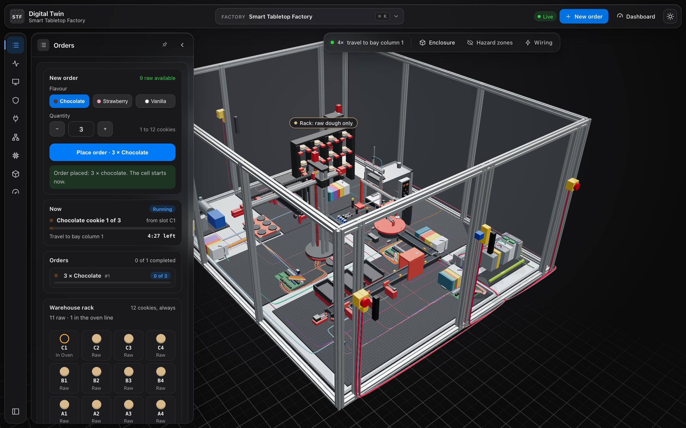
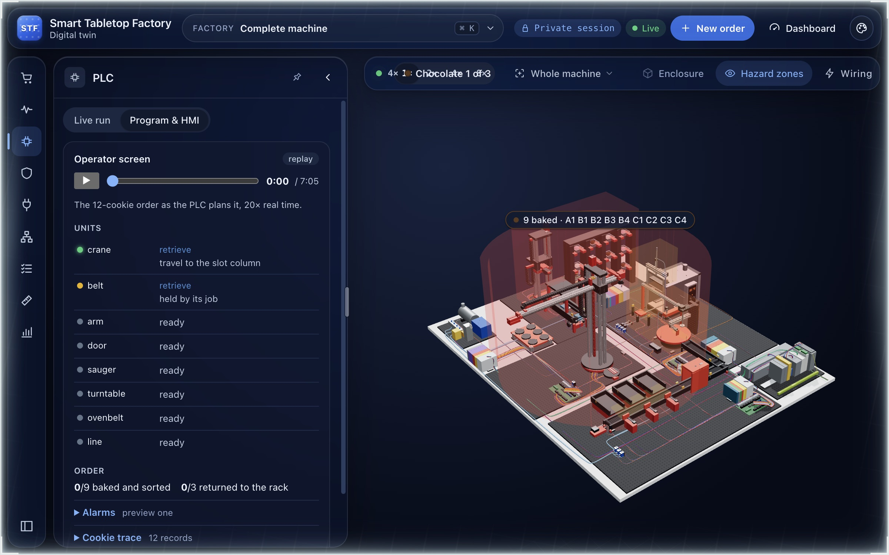
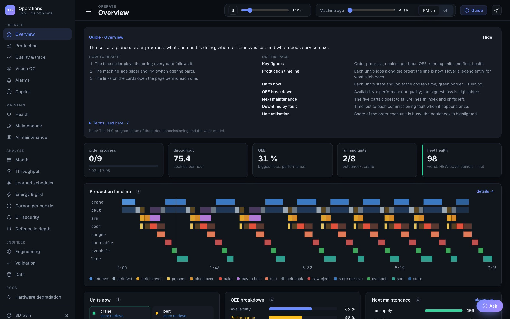
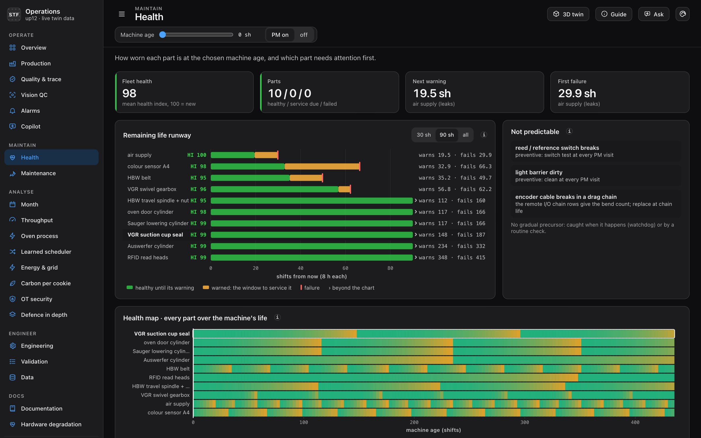
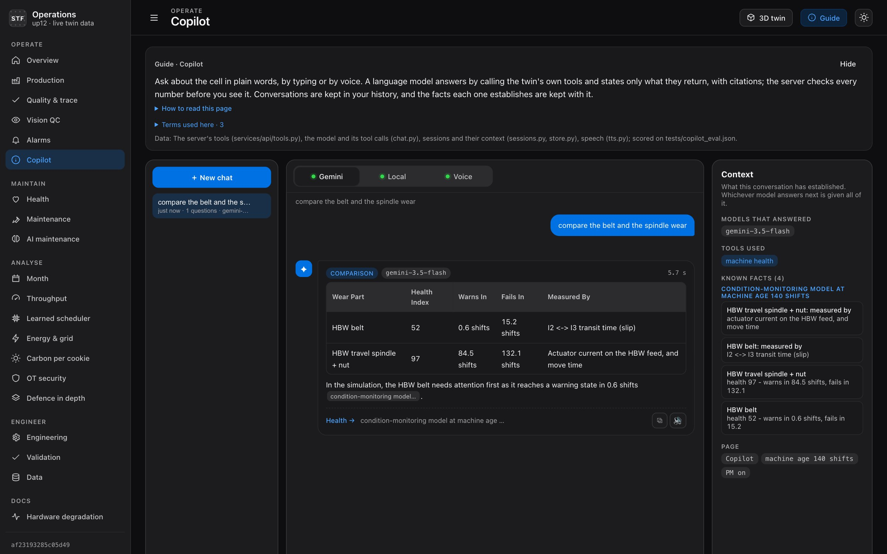
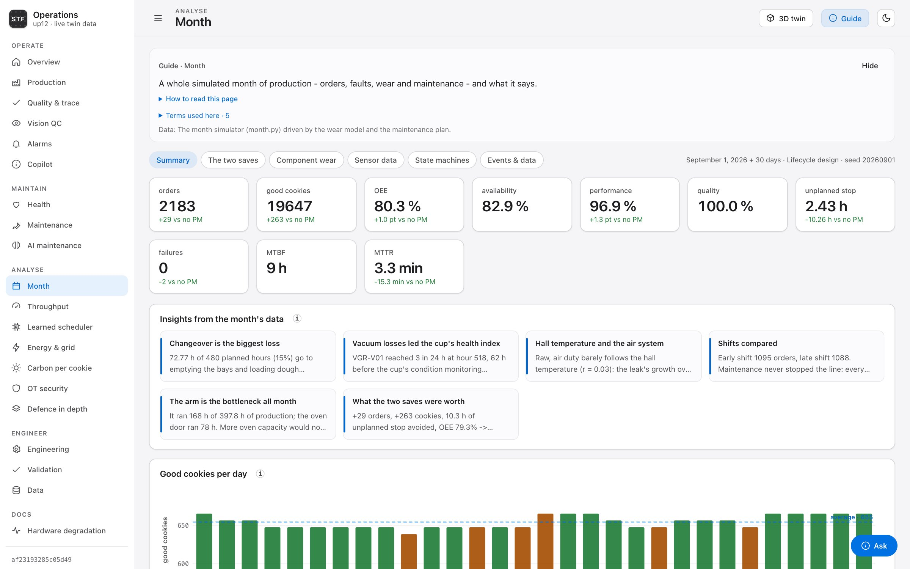
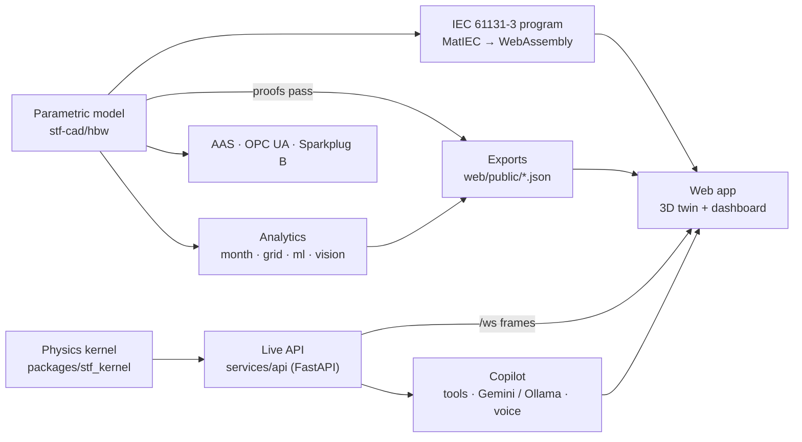

# STF Digital Twin

**A proven digital twin of the fischertechnik *Fabrik Simulation 24V* (536634): 3D, live, with its real PLC program running in your browser.**

One parametric model is the single source of truth for the CAD, the kinematics, the wiring and I/O, the
generated PLC program and the analytics. Nothing is exported unless its proofs pass, so the machine you see,
the program that drives it and the numbers on the dashboard can never drift apart.

<p align="center">
  
</p>

<p align="center">
  <a href="https://stf-twin.onrender.com/"><b>Live demo</b></a> ·
  <a href="https://stf-live.onrender.com/stf/"><b>Live twin + copilot</b></a> ·
  <a href="docs/DASHBOARD_GUIDE.md">Dashboard guide</a> ·
  <a href="docs/DEPLOY.md">Deploy</a>
</p>

> The live services run on Render's free tier and sleep when idle. The first visit can take about a minute to wake them.

---

## Contents

- [What's inside](#whats-inside)
- [Screenshots](#screenshots)
- [Architecture](#architecture)
- [Quick start](#quick-start)
- [The AI copilot](#the-ai-copilot)
- [Deploy](#deploy)
- [Regenerate the data](#regenerate-the-data)
- [Tests](#tests)
- [Project layout](#project-layout)
- [Documentation](#documentation)

## What's inside

| | |
|---|---|
| **3D twin** | The whole cell (high-bay warehouse, vacuum gripper robot, oven with turntable, sorting line) in three.js. Place an order and watch it run. Toggle the enclosure, the hazard zones and the wiring. |
| **PLC in the browser** | The generated control program is a full IEC 61131-3 project, compiled by MatIEC to WebAssembly and run against an I/O-level plant model. It shows live units, the I/O image and the job log. |
| **Operations dashboard** | 20+ pages: overview, production, quality and traceability, vision QC, alarms, health and maintenance, a simulated month, throughput, energy and microgrid, carbon per cookie, OT security. Every page has a built-in guide. |
| **Predictive maintenance** | A condition-monitoring model gives a health index and remaining life for every wear part, plus an ML maintenance model and a learned scheduler behind a deadlock shield. |
| **Vision inspection** | A defect-detection CNN, trained only on images rendered from the model, exported to ONNX and run in the browser. |
| **Industry 4.0 connectivity** | Asset Administration Shells (IDTA templates), an OPC UA server on the Machinery companion spec, and MQTT Sparkplug B into an ISA-95 Unified Namespace. Each one has its own conformance checks. |
| **AI copilot** | Ask about the cell by typing or by voice. Answers come from the twin's own tools, with citations, and every number is checked before you see it. See [below](#the-ai-copilot). |
| **Safety and security** | Hazard zones, safety functions with PL checks, IEC 62443 zones and conduits, and defence in depth. The API is read-only unless you are the operator. |

## Screenshots

<table>
  <tr>
    <td width="50%"></td>
    <td width="50%"></td>
  </tr>
  <tr>
    <td><b>PLC program, live.</b> The real program runs in your browser: unit states, the I/O image and the job log, with hazard zones shown.</td>
    <td><b>Inside the enclosure.</b> The guard is hidden and the wiring is shown, with the machine at work on an order.</td>
  </tr>
  <tr>
    <td></td>
    <td></td>
  </tr>
  <tr>
    <td><b>Overview.</b> Order progress, throughput, OEE, the bottleneck and the production timeline of every unit.</td>
    <td><b>Health.</b> The remaining-life runway for each wear part, and the faults that no model can predict.</td>
  </tr>
  <tr>
    <td></td>
    <td></td>
  </tr>
  <tr>
    <td><b>Copilot.</b> A comparison answered as a table from the health model's tool, with the facts it established kept in the context panel.</td>
    <td><b>Month.</b> A whole simulated month of orders, faults, wear and maintenance, compared with the same month without preventive maintenance. Shown in the light theme.</td>
  </tr>
</table>

## Architecture



The web app works in two modes:

- **Static demo** (`npm run build:pages`): the machine, its PLC cycle and every panel are built from the
  generated files. It needs no server. The copilot then answers offline, in the browser.
- **Live** (the Docker image): the FastAPI service streams the simulation over a websocket and serves the
  copilot. The status chip reads **Live**.

## Quick start

Requirements: Python 3.11+ and Node 20+.

```bash
make install
```

```bash
make api
```

```bash
cd web && npm install && npm run dev
```

1. `make install` creates `.venv` with the API and the dev dependencies.
2. `make api` starts the live API on `127.0.0.1:8000`.
3. Open http://localhost:5173/stf/ for the twin, or http://localhost:5173/stf/dashboard.html for the dashboard.

To try the copilot with a cloud model, copy `.env.example` to `.env` and set `GEMINI_API_KEY`. `.env` is
git-ignored; never commit a key. Run `make help` for every other target.

## The AI copilot

The copilot answers questions about the cell from the twin's own data, not from the model's memory.

- **Grounded.** The language model calls the twin's tools (live state, machine health, alarms, the
  production month, page guides, document search) and may state only what those tools return, with sources.
- **Verified.** The server checks every number in an answer against the tool results before it is shown.
  An answer that fails the check is marked.
- **Three ways in.**
  - **Gemini:** cloud models, switching to the next one when one reaches its limit.
  - **Local:** a model on your machine through Ollama.
  - **Voice:** speech-to-text in, spoken answers out.
- **Context that travels.** Conversations are stored as JSON documents. Each one keeps a context store of
  the facts it has established, so whichever model answers next (Gemini, another Gemini, the local model)
  carries on without losing anything.
- **Shaped answers.** A comparison comes back as a table, an alarm as numbered steps, "what is happening now"
  as a status card.
- **Speech pipeline.** ElevenLabs, then Gemini TTS, then a local voice, whichever is available. See
  [`docs/TTS_PIPELINE.md`](docs/TTS_PIPELINE.md).

Configuration lives in environment variables (`.env.example` lists them all):

| Variable | Purpose |
|---|---|
| `GEMINI_API_KEY` | Enables the Gemini tab. |
| `GEMINI_MODELS` | Models to try in turn. |
| `OLLAMA_MODEL` | The local model. Leave it empty to disable. |
| `ELEVENLABS_API_KEY` | Optional. The first voice when set. |
| `STF_DATA_DIR` | Where chat sessions are stored (default `.data/`). |

## Deploy

[`render.yaml`](render.yaml) is a Render Blueprint. In Render, choose **New → Blueprint**, select this repo,
and it creates two services:

| Service | What | URL |
|---|---|---|
| `stf-twin` | The static demo (no API) | `https://stf-twin.onrender.com/` |
| `stf-live` | The API and the app in one Docker container, with the copilot | `https://stf-live.onrender.com/stf/` |

Set `GEMINI_API_KEY` (and optionally `ELEVENLABS_API_KEY`) in the `stf-live` service's environment. For the
step-by-step guide, the free-tier limits and the alternatives, see [`docs/DEPLOY.md`](docs/DEPLOY.md).

Every push to `main` also publishes the static demo to GitHub Pages
([`pages.yml`](.github/workflows/pages.yml)), and CI ([`ci.yml`](.github/workflows/ci.yml)) runs the tests,
lint, type check and dependency audits.

## Regenerate the data

Run these from `stf-cad/hbw` with the project's venv:

```bash
STF_VARIANT=up12 python3 hbw_export.py
```

```bash
python3 validate.py
```

- `hbw_export.py` exports the machine the twin shows, after running every proof first.
- `validate.py` re-proves every variant and runs the mutation tests and robustness checks. It takes about 25 minutes.

Each analytics script (`month.py`, `grid.py`, `ml/train.py`, `throughput.py`, `security.py`,
`hardening.py`) says in its docstring which variant to run it with. The subsystems have their own make
targets, including `make sil`, `make vision`, `make aas`, `make opcua-check`, `make uns-check` and
`make copilot`.

## Tests

```bash
make test
```

```bash
make lint
```

```bash
cd web && npx tsc --noEmit -p . && npm test
```

- `make test` runs the Python suite: kernel, layout, golden trajectories, API access control and the copilot.
- `make lint` runs ruff.
- The last command type-checks the web app and runs its unit tests.

## Project layout

| Path | What |
|---|---|
| `stf-cad/hbw/` | The model and its proofs: geometry, kinematics, wiring, safety, I/O, the generated PLC program, commissioning, health, throughput and security. Also the analytics (`month.py`, `grid.py`, `ml/`). |
| `stf-cad/hbw/sil/` | The PLC program as an IEC 61131-3 project, compiled to WebAssembly and proven against the plant. |
| `stf-cad/hbw/aas/` · `opcua/` · `uns/` | Asset Administration Shells, the OPC UA server and MQTT Sparkplug B / Unified Namespace. |
| `stf-cad/hbw/vision/` | The rendered-image training set, the inspection CNN and its ONNX export. |
| `packages/` | The physics kernel (`stf_kernel`) and the layout (`stf_layout`). |
| `services/api/` | The live API (`/layout`, `/orders`, `/health`, `/ws`, operator-only `POST /command`) and the copilot. |
| `web/` | The 3D twin (`index.html`) and the operations dashboard (`dashboard.html`), built with React and three.js. |
| `docs/` | Guides, the hardware ground truth, the security model and the fischertechnik datasheets. |
| `tests/` | The Python test suite. |

## Documentation

- [`docs/DASHBOARD_GUIDE.md`](docs/DASHBOARD_GUIDE.md): every dashboard page, explained.
- [`docs/DEPLOY.md`](docs/DEPLOY.md): deploying to Render and the alternatives.
- [`docs/VALIDATION.md`](docs/VALIDATION.md): what is proven, and how.
- [`docs/SECURITY.md`](docs/SECURITY.md): the API's access model and the operator token.
- [`docs/TTS_PIPELINE.md`](docs/TTS_PIPELINE.md): the speech pipeline.
- [`docs/HARDWARE_MODEL.md`](docs/HARDWARE_MODEL.md) and [`docs/FACTORY_GROUND_TRUTH.md`](docs/FACTORY_GROUND_TRUTH.md): the real machine, from the manuals.
- [`docs/UPGRADE_PLAN.md`](docs/UPGRADE_PLAN.md): how the twin grew, step by step.
