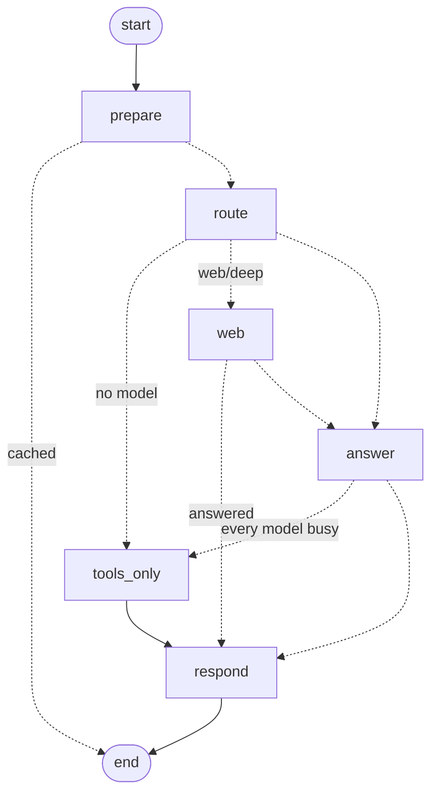

# The copilot as an agent graph (LangGraph on Cloud Run)

How the copilot's answer pipeline runs as a LangGraph state machine inside the existing
`stf-live` Cloud Run service, what is built, what each later phase adds, which loops an
industrial agent needs and how each is bounded, and what it costs on the $300 trial credit.

Code: `services/api/agent.py` (the graph), `services/api/gcp_auth.py` (Vertex AI tokens),
`services/api/chat.py` (the providers, tools loop, budgets). Tests: `tests/test_agent.py`,
`tests/test_vertex.py`. Live drawing: `GET /chat/graph`.

## 1. Decisions

| Decision | Choice | Why |
|---|---|---|
| Orchestration | **LangGraph 1.2** (`langgraph` only; `langchain-core` comes with it, `langchain`/`langchain-community` are not used) | Explicit state machine, checkpoints, `interrupt()` for human approval, `Send` fan-out, subgraphs - the parts that are expensive to make reliable by hand |
| Router | **Rules stay on top** (`orchestrate.decide` is the `route` node) | A model never decides to spend a web search or to actuate; the route and its reasons are returned with every answer |
| Models | The existing ladder (Vertex/Studio Gemini -> Groq -> UPB -> open model -> Ollama -> tools), called from nodes | Its cooldowns, token tiers and number check already work; LangChain's `with_fallbacks` would be a downgrade |
| Hosting | **Inside `stf-live` on Cloud Run** (scale to zero) | No second service, no extra bill. Vertex AI Agent Engine was rejected: ~$75/month for an always-on runtime Cloud Run gives for ~$0 |
| Paid model | **Gemini on Vertex AI** via the service account's OAuth token | What the trial credit pays for; the AI Studio endpoint may not be |
| Engine switch | `STF_AGENT=graph` (default) / `linear` | Kill switch: the same nodes run as a plain loop, so rollback is an env var, not a deploy |

## 2. What is built (phase 1)



| Node | Does | Calls |
|---|---|---|
| `prepare` | session turns and remembered facts, rules router's tool calls, repeat-question cache | `sessions`, `tools.rules_answer` |
| `route` | chat/twin/docs/web/deep by rules; style; depth; provider ladder; daily cap | `orchestrate.decide`, `respond.classify`, `depth.pick` |
| `web` | search ladder (Gemini grounding, Groq browser search, DuckDuckGo), literature when thorough, source policy | `Chat._web_*`, `scholar`, `source_policy` |
| `answer` | the model ladder; each provider runs its own tool loop and number check; failures hand over | `Chat._gemini/_groq/_upb/_openai/_ollama` |
| `tools_only` | the twin's tools answer in the rules mode's words | `chat.fallback` |
| `respond` | payload (vetted links, cites, steps, usage), session turn, cache | `source_policy.strip_links`, `sessions` |

**State vs context.** The graph *state* holds only what edges decide on and what a checkpoint
would keep: `mode`, `web`, `rules`, `why`, `outcome`, `out`. The per-request working memory
(HTTP request, the stream's `emit`, tool results the model loops append to) is a `Question`
passed as LangGraph *runtime context* (`context_schema`) - never checkpointed, so no guest data
lands in a checkpoint store.

**Parity, verified.** Both engines pass the full suite (489 tests) and give identical payloads
and event streams for rules / model / web / all-busy questions (`test_both_engines_answer_alike`).
`eval_copilot --provider rules`: held-out tools 8/12, facts 11/12, faithful 12/12 on both
engines - unchanged from the baseline. Live on :8000 a twin question routed `twin`, called
`machine_health`, answered by Groq gpt-oss-120b in 1.4 s, nothing unverified.

**Streaming** is unchanged: nodes call `Question.say`, which feeds the same FIFO the SSE
endpoint drains (`/chat/stream` route/step/thinking/answer).

## 3. The loops, and how each is bounded

Every loop has a hard cap, a stop condition and an exit. An industrial agent never loops open.

| # | Loop | Where | Cap | Exit on failure | Status |
|---|---|---|---|---|---|
| 1 | **Tool use (ReAct)**: model -> tool calls -> results -> model | `answer` (per provider today) | `MAX_ROUNDS=4`, then a forced answer without tools | next provider | built ×5; phase 2 unifies into one node + adapters |
| 2 | **Verify-correct**: number check, one corrected retry | inside loop 1 (`verify.py`) | 1 retry | answer flagged `unverified` with a note | built; phase 2 lifts it into a `verify` node |
| 3 | **Corrective retrieval (CRAG)**: grade passages -> rewrite -> retrieve again | `docs_rag` subgraph | 1 rewrite | `web` if search allowed, else "documents don't cover it" | phase 3 (`rewrite.py`, reranker seam exist) |
| 4 | **Plan -> fan-out -> combine -> critic -> replan** | `research` / root-cause subgraph, `Send` | ≤3 sub-tasks, ≤2 replans, fan-out width from `token_budget` tier | write up what was found, say what is missing | phase 3 (deep route's planner is the seed) |
| 5 | **Act with human approval**: propose -> deterministic precheck -> `interrupt()` -> execute -> observe postcondition | `actuation` subgraph | 1 proposal per approval; observe timeout | compensate or escalate; never retries an actuation by itself | phase 5 |
| 6 | **Event-driven monitoring**: alarms/RUL -> filter/group (deterministic) -> triage graph -> notify | background task on `livehub`/MQTT | debounce + per-hour cap (`STF_NOTIFY_MAX_PER_HOUR`) | notify only; actions still go through loop 5 | phase 6 |
| 7 | **Offline improvement**: trace -> feedback -> golden candidates -> eval gate | CI | held-out set never tunes anything | shadow mode before switching the engine default | phase 7 |

### Loop 5 in detail (the industrial core)

```
propose      LLM fills a typed ActionProposal {op, slot|scenario|target, reason, evidence}
precheck     DETERMINISTIC: PLC mode (auto/manual), S-1 safety state, interlocks, the 12-order
             queue rule, slot pattern A1..C4 (CommandRequest), operator token present
interrupt()  graph pauses, checkpoint saved; dashboard shows the proposal; operator approves
             or rejects (minutes later is fine: the run resumes from the checkpoint)
execute      command_guard + runtime.submit (the same path as POST /command)
observe      poll live_state until the postcondition holds or a timeout
confirm      report; on timeout: compensate (home) or escalate to the operator
```

The model never writes to the PLC or `/command`; it only fills a proposal a rule checker and a
person both have to accept. This is the only loop that needs a durable checkpointer, which is
why phase 1 compiles without one.

## 4. Phases

| Phase | Adds | Gate |
|---|---|---|
| **1 - done** | graph wraps the pipeline; engine switch; `/chat/graph`; Vertex AI lane; cloud cap sized to the credit | full suite on both engines; eval unchanged |
| 2 | one tool-loop node + provider adapters (deletes the five copies in `chat.py`); `verify` node; tool results move from context into state with an append reducer | eval per provider unchanged or better |
| 3 | `docs_rag` (CRAG, loop 3) and `research` (loop 4) subgraphs with `Send` | retrieval eval (hit@k, MRR) and deep-question faithfulness |
| 4 | tracing: OpenTelemetry spans per node -> Langfuse (self-host or hobby tier) or Phoenix; one trace id per question, shown in the thinking drawer | traces for 100 % of eval questions |
| 5 | `actuation` subgraph (loop 5) + Postgres checkpointer on Supabase (`langgraph-checkpoint-postgres`), checkpoints deleted with the guest (`DELETE /guest`, `STF_GUEST_DAYS`) | precheck mutants (every interlock refuses), approval round trip test |
| 6 | monitoring loop (loop 6) over `livehub` + Sparkplug B (`stf-cad/hbw/uns`) | no LLM call per frame; alarm-flood test |
| 7 | tools as an MCP server; eval gate in CI; shadow runs | CI blocks on held-out regression |

## 5. Deployment on Cloud Run

Nothing new to deploy: the graph is in the `stf-live` image (`langgraph` is pinned with
hashes in `requirements-api.txt`). LangSmith ships with `langchain-core` but sends nothing
unless `LANGSMITH_TRACING` and a key are set - neither is.

**Vertex AI lane (the trial credit).** The cloud lane calls Vertex AI when
`GEMINI_VERTEX_PROJECT` is set; the token comes from the service account through the metadata
server (no secret), or from `gcloud` on a laptop. It is asked before the AI Studio key, with its
own models, cooldowns and budget (`GEMINI_CLOUD_*`). Verified 2026-10-23: `gemini-3.8-flash`
answers on the `global` endpoint for project `smart-tabletop-factory-512013` (Vertex API
enabled). Still needed, by the owner:

```bash
gcloud projects add-iam-policy-binding smart-tabletop-factory-512013 \
  --member="serviceAccount:500754517962-compute@developer.gserviceaccount.com" \
  --role="roles/aiplatform.user"
gcloud run services update stf-live --region europe-west1 \
  --update-env-vars GEMINI_VERTEX_PROJECT=smart-tabletop-factory-512013,GEMINI_CLOUD_MODELS=gemini-3.8-flash,gemini-3.5-flash
```

Then confirm in the console (Billing -> Credits) that the Vertex calls draw on the trial
credit, and set a budget alert at $250.

## 6. Cost

Per question at Gemini 3.8 Flash list price ($0.75 in / $3.75 out per 1M tokens; thinking is
billed as output; introductory, reported to double on 2027-01-01):

| Question | Calls | Tokens in / out | Cost |
|---|---|---|---|
| twin / docs | 2-3 | ~15k / ~2-3k | ~$0.02 |
| deep / root cause (phase 3) | 6-8 | ~100k / ~8k | ~$0.10-0.15 |

| Month | Light (10 q/day) | Busy (50 q/day + 5 deep) |
|---|---|---|
| Vertex Gemini | ~$6 | ~$35-50 |
| Cloud Run (scale to zero) + reranker | ~$1-5 | ~$8-13 |
| Checkpoints (Supabase), tracing (hobby/self-host) | $0 | $0 |

Guard rails: `TB.CLOUD` is 2.5M tokens/day (~$2.6/day at the cap, ~$240 over 90 days - inside
the credit) and 40 grounded searches/day (grounding is billed per query beyond a free
allowance; Groq and DuckDuckGo search for free after that). After the credit, unset
`GEMINI_VERTEX_PROJECT` and the ladder falls back to the free providers at ~$0.

## 7. Traps

- **Context vars.** The token meter is a `contextvar` set before the graph runs; LangGraph copies
  the context into each node, and the meter dict is shared by reference, so usage still adds up.
- **Pool cooldowns are in memory.** With `--max-instances 2` two instances learn limits
  separately; move them to the store before scaling out (roadmap D9).
- **A missing Vertex token is not an error.** The lane rests for 5 minutes and AI Studio / Groq
  answer (`test_no_token_hands_over_to_ai_studio`).
- **Tests never reach Google.** `conftest.py` blanks `GEMINI_VERTEX_PROJECT` and
  `GEMINI_CLOUD_API_KEY`; this laptop's `gcloud` login would otherwise be used.
