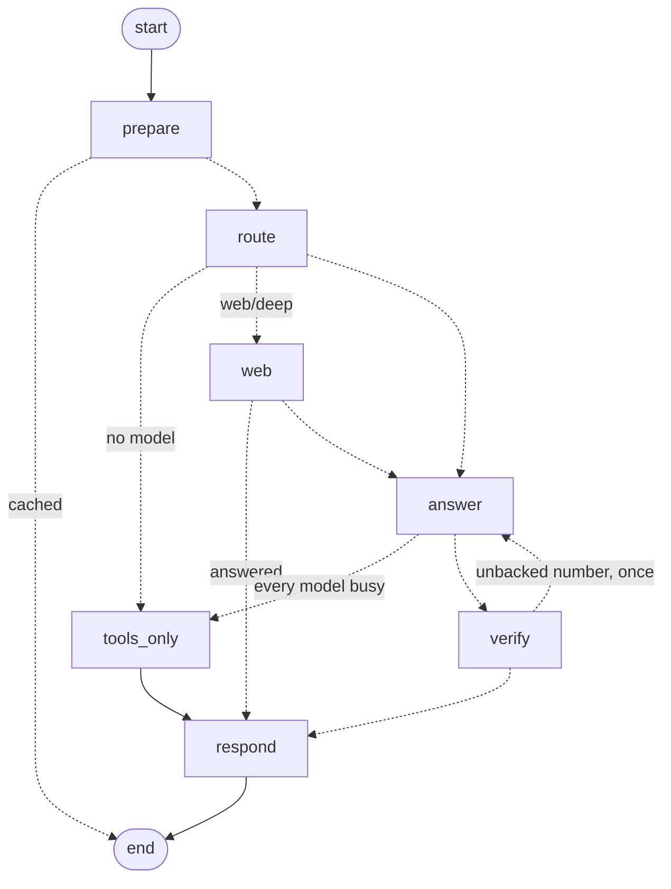

# The copilot as an agent graph (LangGraph on Cloud Run)

How the copilot's answer pipeline runs as a LangGraph state machine inside the existing
`stf-live` Cloud Run service, what is built, what each later phase adds, which loops an
industrial agent needs and how each is bounded, and what it costs on the $300 trial credit.

Code: `services/api/agent.py` (the graph), `services/api/toolloop.py` (the one tool loop and
its provider adapters), `services/api/crag.py` (corrective retrieval), `services/api/gcp_auth.py` (Vertex AI tokens), `services/api/chat.py`
(the providers' transports, budgets, web search). Tests: `tests/test_agent.py`,
`tests/test_toolloop.py`, `tests/test_crag.py`, `tests/test_research.py`,
`tests/test_golden_requests.py`, `tests/test_tracing.py`, `tests/test_vertex.py`; tracing in
`services/api/tracing.py`. Live drawing: `GET /chat/graph`.

## 1. Decisions

| Decision | Choice | Why |
|---|---|---|
| Orchestration | **LangGraph 1.2** (`langgraph` only; `langchain-core` comes with it, `langchain`/`langchain-community` are not used) | Explicit state machine, checkpoints, `interrupt()` for human approval, `Send` fan-out, subgraphs - the parts that are expensive to make reliable by hand |
| Router | **Rules stay on top** (`orchestrate.decide` is the `route` node) | A model never decides to spend a web search or to actuate; the route and its reasons are returned with every answer |
| Models | The existing ladder (Vertex/Studio Gemini -> Groq -> UPB -> open model -> Ollama -> tools), called from nodes | Its cooldowns, token tiers and number check already work; LangChain's `with_fallbacks` would be a downgrade |
| Hosting | **Inside `stf-live` on Cloud Run** (scale to zero) | No second service, no extra bill. Vertex AI Agent Engine was rejected: ~$75/month for an always-on runtime Cloud Run gives for ~$0 |
| Paid model | **Gemini on Vertex AI** via the service account's OAuth token | What the trial credit pays for; the AI Studio endpoint may not be |
| Engine switch | `STF_AGENT=graph` (default) / `linear` | Kill switch: the same nodes run as a plain loop, so rollback is an env var, not a deploy |

## 2. What is built (phases 1 and 2)



| Node | Does | Calls |
|---|---|---|
| `prepare` | session turns and remembered facts, rules router's tool calls, repeat-question cache | `sessions`, `tools.rules_answer` |
| `route` | chat/twin/docs/web/deep by rules; style; depth; provider ladder; daily cap | `orchestrate.decide`, `respond.classify`, `depth.pick` |
| `web` | search ladder (Gemini grounding, Groq browser search, DuckDuckGo), literature when thorough, source policy | `Chat._web_*`, `scholar`, `source_policy` |
| `answer` | the model ladder; each provider runs the one tool loop through its adapter; failures hand over | `Chat.conversation`, `toolloop.Conversation.run` |
| `verify` | the number check; an answer with a number nothing backs goes back to the model that wrote it, once | `verify.unverified`, `Conversation.correct` |
| `tools_only` | the twin's tools answer in the rules mode's words | `chat.fallback` |
| `respond` | payload (vetted links, cites, steps, usage), session turn, cache | `source_policy.strip_links`, `sessions` |

**State vs context.** The graph *state* holds only what edges decide on and what a checkpoint
would keep: `mode`, `web`, `rules`, `why`, `retry`, `outcome`, `out`. The per-request working memory
(HTTP request, the stream's `emit`, tool results the model loops append to) is a `Question`
passed as LangGraph *runtime context* (`context_schema`) - never checkpointed, so no guest data
lands in a checkpoint store.

**Parity, verified.** Both engines pass the full suite (489 tests) and give identical payloads
and event streams for rules / model / web / all-busy questions (`test_both_engines_answer_alike`).
`eval_copilot --provider rules`: held-out tools 8/12, facts 11/12, faithful 12/12 on both
engines - unchanged from the baseline. Live on :8000 a twin question routed `twin`, called
`machine_health`, answered by Groq gpt-oss-120b in 1.4 s, nothing unverified.

**Streaming** is unchanged: nodes call `Question.say`, which feeds the same FIFO the SSE
endpoint drains (`/chat/stream` route/step/thinking/answer).

## 2b. Phase 2's gate: same behaviour, measured three ways

1. **Byte-identical requests.** One scripted conversation per provider (a tool call, an
   answer with a number nothing backs, the corrected answer) was recorded on the five old loops
   and replayed on the new tool loop + verify node: Gemini, Groq and Ollama are sent identical
   requests and give the same answer, on both engines. The recording is kept as a golden test
   (`tests/test_golden_requests.py`, `tests/golden/copilot_requests.json`).
2. **Unit and parity tests.** 506 tests on each engine, among them each adapter's tool
   round trip, the correction sent once and only once, a failed correction keeping the first
   answer flagged, and the final no-tools answer never being sent back.
3. **Model eval** (`eval_copilot --provider ollama`, qwen2.5:7b-instruct, local):

   | Run | tuning faithful | held-out tools | held-out facts | held-out faithful | flagged |
   |---|---|---|---|---|---|
   | phase 1 (old loops) | 28/29 | 9/12 | 12/12 | 11/12 | 2 |
   | phase 2, graph | 27/29 | 8/12 | 12/12 | 11/12 | 3 |
   | phase 2, linear | 27/29 | 8/12 | 12/12 | 11/12 | 3 |

   The differences are the model's sampling, not the code: graph and linear run the same code
   and still disagree on two questions, and the two questions that differ from phase 1 were
   asked five more times on each version - "where do we lose most time in an order?" called
   `oee_bottleneck` 2/5 times on the old code and 1/5 on the new, "does the battery pay off?"
   was verified 5/5 and 4/5. With (1) showing identical requests, the eval is read as
   unchanged. The real finding is that qwen2.5-7b picks `oee_bottleneck` unreliably for that
   paraphrase - a router or tool-description fix, not a loop fix. Every unbacked number in all
   three runs was caught and flagged by the number check.

Behaviour changes, deliberate: an answer from UPB was labelled with the local model's name (a
bug in the old dispatch) and now carries UPB's; Ollama now reports "called X" steps and every
provider reports "checking: ..." when an answer is sent back; a correction that fails (the
provider errors on the second request) keeps the first answer, flagged, instead of handing the
question to the next provider.

## 2c. Phase 3: corrective retrieval and the research graph

**Why a model judges.** Cheap signals were tried first as the grader - BM25 score, word cover,
cosine, the top-two margin - and on this corpus they do not separate hits from misses: the
router's own "strong match" thresholds graded all 16 golden questions strong, the outright miss
included. The grade needs a reader: a small model listing the passages that help (one call,
~900 tokens), which reranks them too. The cross-encoder (`STF_RERANKER_URL`) is the other
reader, once deployed.

**Retrieval** (`eval_retrieval.py --judge`, hash embedder, 16 golden questions):

| Retrieval | MRR | hit@1 | hit@3 | hit@8 | nDCG |
|---|---|---|---|---|---|
| hybrid search (phase 2) | 0.642 | 0.50 | 0.81 | 0.875 | 0.689 |
| judge = qwen2.5-7b (local) | **0.799** | **0.75** | 0.81 | 0.875 | **0.765** |
| rewrite every question, then judge (rejected) | 0.705 | 0.63 | - | 0.875 | - |
| judge = Groq gpt-oss-20b (free tier) | 0.629 | 0.50 | 0.69 | 0.875 | 0.693 |

Two design decisions came from these numbers. The rewrite runs only when the judge finds
nothing (rewriting every question adds candidates the original did not need), and a "none"
keeps the passages instead of dropping them (dropping lost a hit: hit@8 0.875 -> 0.812). The
Groq row is not a judgment of the model: after 7 questions Groq's free tier answered HTTP 429
and the rest ran unjudged, which is the safe fallback working (the search's order stands). In
production put the billed lane first - `STF_QUICK_ORDER=gemini,groq,ollama` once Vertex AI is
on - and a rate-limited helper now rests 60 s on its own key without resting the chat's models.

**Deep research** - the old per-provider loops (`GS.deep`, `W.deep`, `W.deep_ddg`: plan, then
the sub-searches one after another on one provider, no critic) are replaced in the graph by
`plan` -> `search` ×N -> `critic` -> `gather`. Each branch has the whole search ladder, so a
provider failing mid-research costs one search, not the research; Gemini's deep allowance
still bounds the count and the tokens when Gemini searches first (the budget test counts plan,
searches, critic and write-up on the AI Studio budget).

**Deep-research gate: verified by tests, not yet measured live.** A live comparison against
phase 2 needs working web search, and none was available from the development machine on
free tiers: DuckDuckGo answered every search with its bot check (HTTP 202, "anomaly"), Groq's
free tier allows ~8k tokens a minute against ~30k for one browser search, and the AI Studio
key has no Google Search grounding quota. A first attempt also exposed a real gap, now fixed:
the router counted only Groq and Gemini as able to search, so a setup with DuckDuckGo and a
writer model (UPB, an open model) could never route to web or deep research
(`Chat.can_search`, `test_duckduckgo_with_a_writer_counts_as_a_search_provider`).

What is verified deterministically, on both engines (`tests/test_research.py`,
`tests/test_orchestrate.py`, `tests/test_gemini_search.py`): the plan fans out and the
findings are gathered in plan order; never more than `AT_ONCE` searches in flight; the critic
adds a round for what is missing, never repeats a search and stops after `MAX_REPLANS`; a
failed branch costs only itself and all failing still answers; the token ceiling stops further
branches; Gemini's budget counts plan, searches, critic and write-up; LangGraph and the linear
engine take the same path.

To measure it live once the Vertex AI lane is on (grounded search needs billing), on staging:
`WEB_SEARCH_ORDER=gemini,groq STF_QUICK_ORDER=gemini,groq` and the five research questions in
the gate script, phase 2 against phase 3: faithfulness (`unverified`), web sources and how many
are trusted, searches run and failed, tokens and seconds per question.

## 2d. Phase 4: one trace per question

```
copilot.question                       route, model, tokens, outcome (hashed user, session id)
  node.prepare · node.route · node.docs_rag · node.plan · node.search ×N · node.critic ...
    llm.<provider>                     model, input/output tokens
    tool.<name>                        the tool the model called
    search.<provider>                  one attempt down the search ladder: found, sources
    llm.quick                          a helper call: judge, rewrite, plan, critic
  node.answer · node.verify · node.respond
```

- **One trace per question**, started in `agent.run` around either engine; nodes are wrapped
  once (`agent.traced`), so LangGraph and the linear engine produce the same spans (the parity
  tests compare span structure). OpenTelemetry's context rides contextvars, so spans opened in
  worker threads (`asyncio.to_thread`) and in fan-out branches nest under the right node.
- **Two vocabularies on every span**: OpenTelemetry GenAI (`gen_ai.request.model`,
  `gen_ai.usage.*`, read by Langfuse, plus `langfuse.*` trace name, session and user) and
  OpenInference (`openinference.span.kind` LLM/TOOL/RETRIEVER/CHAIN/AGENT, `llm.*`, read by
  Phoenix).
- **Where it goes**: always into an in-process collector, from which `respond` takes the
  question's finished spans into the reply (`trace: {id, ms, stores, spans}`) and the
  session's turn; additionally to every configured store through a `BatchSpanProcessor`
  (export never blocks an answer). A cached reply gets a trace of its own.
- **Privacy by default**: exported traces carry metadata only; the question and answer go out
  only with `STF_TRACE_CONTENT=1`, a research branch's sub-question likewise. The guest is a
  salted hash (`langfuse.user.id`), never the address. Tests blank every exporter variable, so
  a test run never reaches a real trace store.
- **The drawer** (`Message.tsx` `TraceView`): the trace id (copyable - the id Langfuse and
  Phoenix show), where it was exported, and a waterfall: each span's offset and duration,
  indented under its node, with the model and tokens, the verdict or the error.

Verified: `tests/test_tracing.py` decodes the OTLP protobuf a local receiver gets - one trace
id equal to the reply's, both vocabularies present, Langfuse's path and basic-auth header, no
question text unless asked, no address. Live on the development API a docs question traced 13
spans over 19.75 s and showed what no log line had: `gemini-3.5-flash` took 13.0 s before it
failed on its second call, Groq answered in 2.1 s, verify sent one unbacked number back once,
and the passage judge cost 485 ms (975 tokens in).

**To export**: Langfuse - create a project (cloud.langfuse.com or self-hosted), set
`LANGFUSE_PUBLIC_KEY`/`LANGFUSE_SECRET_KEY` (and `LANGFUSE_HOST` if self-hosted) as Cloud Run
secrets. Phoenix - run it (`phoenix serve` after `pip install
arize-phoenix`, or its container) and set `PHOENIX_COLLECTOR_ENDPOINT`. The status endpoint's
`tracing.stores` says where traces go.

## 3. The loops, and how each is bounded

Every loop has a hard cap, a stop condition and an exit. An industrial agent never loops open.

| # | Loop | Where | Cap | Exit on failure | Status |
|---|---|---|---|---|---|
| 1 | **Tool use (ReAct)**: model -> tool calls -> results -> model | `answer` -> `toolloop.Conversation.run` | `MAX_ROUNDS=4` (+1 shared with the correction), then a forced answer without tools | next provider | **built once** (phase 2): five adapters, one loop |
| 2 | **Verify-correct**: number check, one corrected retry | `verify` node -> back to `answer` | 1 correction (`Conversation.corrected`); graph `recursion_limit` 12 | answer stands, flagged `unverified` with a note | **built** (phase 2) |
| 3 | **Corrective retrieval (CRAG)**: judge passages -> (none help) rewrite -> retrieve, fuse, judge again | `docs_rag` node (`crag.py`) | 1 rewrite; 1-3 small-model calls | "none": passages kept, the web for a question not about the twin (never against the operator's Docs choice); no model: the search's order stands | **built** (phase 3) |
| 4 | **Plan -> fan-out -> critic -> replan** | `plan` -> `search` ×N (`Send`) -> `critic` -> `gather` | `depth.subs` sub-questions, `MAX_REPLANS=2` critic rounds, `AT_ONCE=2` in flight, token ceiling (Gemini's deep allowance or `STF_RESEARCH_TOKENS`) | a failed branch costs only itself; all failed: the answer says so | **built** (phase 3) |
| 5 | **Act with human approval**: propose -> deterministic precheck -> `interrupt()` -> execute -> observe postcondition | `actuation` subgraph | 1 proposal per approval; observe timeout | compensate or escalate; never retries an actuation by itself | phase 5 |
| 6 | **Event-driven monitoring**: alarms/RUL -> filter/group (deterministic) -> triage graph -> notify | background task on `livehub`/MQTT | debounce + per-hour cap (`STF_NOTIFY_MAX_PER_HOUR`) | notify only; actions still go through loop 5 | phase 6 |
| 7 | **Offline improvement**: trace -> feedback -> golden candidates -> eval gate | CI | held-out set never tunes anything | shadow mode before switching the engine default | phase 7 |

### Loop 5 in detail (the industrial core)

```
propose      LLM fills a typed ActionProposal {op, slot|scenario|target, reason, evidence}
precheck     DETERMINISTIC: PLC mode (auto/manual), S-1 safety state, interlocks, the 12-order
             queue rule, slot pattern A1..C4 (CommandRequest), operator token present
interrupt()  graph pauses, checkpoint saved; dashboard shows the proposal; operator approves
             or rejects (minutes later is fine: the run resumes from the checkpoint)
execute      command_guard + runtime.submit (the same path as POST /command)
observe      poll live_state until the postcondition holds or a timeout
confirm      report; on timeout: compensate (home) or escalate to the operator
```

The model never writes to the PLC or `/command`; it only fills a proposal a rule checker and a
person both have to accept. This is the only loop that needs a durable checkpointer, which is
why phase 1 compiles without one.

## 4. Phases

| Phase | Adds | Gate |
|---|---|---|
| **1 - done** | graph wraps the pipeline; engine switch; `/chat/graph`; Vertex AI lane; cloud cap sized to the credit | full suite on both engines; eval unchanged |
| **2 - done** | one tool loop + five provider adapters (`toolloop.py`; the five copies left `chat.py`, 2008 -> 1402 lines); `verify` node with the correction edge back to `answer` | golden requests identical; 506 tests on both engines; Ollama eval within sampling noise (section 2b) |
| **3 - done** | `docs_rag` (CRAG, loop 3, `crag.py`); deep research as `plan` -> `search` ×N -> `critic` -> `gather` with `Send` fan-out on LangGraph and `asyncio.gather` on the linear engine; the branches' findings in state with an add reducer; `Chat.quick` for the helpers (`STF_QUICK_ORDER`) | retrieval eval with the judge (section 2c); deep questions against phase 2 (section 2c); 529 tests on both engines |
| **4 - done** | tracing (`tracing.py`): one OpenTelemetry trace per question, a span per node and per model, tool, search and helper call; exported over OTLP/HTTP to Langfuse, Phoenix or any collector; the reply carries its trace and the thinking drawer draws it as a waterfall | 82/82 eval replies traced (41 questions × 2 engines), distinct ids; OTLP export decoded on the wire for Phoenix and Langfuse (section 2d) |
| 5 | `actuation` subgraph (loop 5) + Postgres checkpointer on Supabase (`langgraph-checkpoint-postgres`), checkpoints deleted with the guest (`DELETE /guest`, `STF_GUEST_DAYS`) | precheck mutants (every interlock refuses), approval round trip test |
| 6 | monitoring loop (loop 6) over `livehub` + Sparkplug B (`stf-cad/hbw/uns`) | no LLM call per frame; alarm-flood test |
| 7 | tools as an MCP server; eval gate in CI; shadow runs | CI blocks on held-out regression |

## 5. Deployment on Cloud Run

Nothing new to deploy: the graph is in the `stf-live` image (`langgraph` is pinned with
hashes in `requirements-api.txt`). LangSmith ships with `langchain-core` but sends nothing
unless `LANGSMITH_TRACING` and a key are set - neither is.

**Vertex AI lane (the trial credit).** The cloud lane calls Vertex AI when
`GEMINI_VERTEX_PROJECT` is set; the token comes from the service account through the metadata
server (no secret), or from `gcloud` on a laptop. It is asked before the AI Studio key, with its
own models, cooldowns and budget (`GEMINI_CLOUD_*`). Verified 2026-10-23: `gemini-3.8-flash`
answers on the `global` endpoint for project `smart-tabletop-factory-512013` (Vertex API
enabled). Still needed, by the owner:

```bash
gcloud projects add-iam-policy-binding smart-tabletop-factory-512013 \
  --member="serviceAccount:500754517962-compute@developer.gserviceaccount.com" \
  --role="roles/aiplatform.user"
gcloud run services update stf-live --region europe-west1 \
  --update-env-vars "^@^GEMINI_VERTEX_PROJECT=smart-tabletop-factory-512013@GEMINI_CLOUD_MODELS=gemini-3.8-flash,gemini-3.5-flash"
```

Then confirm in the console (Billing -> Credits) that the Vertex calls draw on the trial
credit, and set a budget alert at $250.

## 6. Cost

Per question at Gemini 3.8 Flash list price ($0.75 in / $3.75 out per 1M tokens; thinking is
billed as output; introductory, reported to double on 2027-01-01):

| Question | Calls | Tokens in / out | Cost |
|---|---|---|---|
| twin / docs | 2-3 | ~15k / ~2-3k | ~$0.02 |
| deep / root cause (phase 3) | 6-8 | ~100k / ~8k | ~$0.10-0.15 |

| Month | Light (10 q/day) | Busy (50 q/day + 5 deep) |
|---|---|---|
| Vertex Gemini | ~$6 | ~$35-50 |
| Cloud Run (scale to zero) + reranker | ~$1-5 | ~$8-13 |
| Checkpoints (Supabase), tracing (hobby/self-host) | $0 | $0 |

Guard rails: `TB.CLOUD` is 2.5M tokens/day (~$2.6/day at the cap, ~$240 over 90 days - inside
the credit) and 40 grounded searches/day (grounding is billed per query beyond a free
allowance; Groq and DuckDuckGo search for free after that). After the credit, unset
`GEMINI_VERTEX_PROJECT` and the ladder falls back to the free providers at ~$0.

## 7. Traps

- **Context vars.** The token meter is a `contextvar` set before the graph runs; LangGraph copies
  the context into each node, and the meter dict is shared by reference, so usage still adds up.
- **Pool cooldowns are in memory.** With `--max-instances 2` two instances learn limits
  separately; move them to the store before scaling out (roadmap D9).
- **A missing Vertex token is not an error.** The lane rests for 5 minutes and AI Studio / Groq
  answer (`test_no_token_hands_over_to_ai_studio`).
- **Tests never reach Google.** `conftest.py` blanks `GEMINI_VERTEX_PROJECT` and
  `GEMINI_CLOUD_API_KEY`; this laptop's `gcloud` login would otherwise be used.
