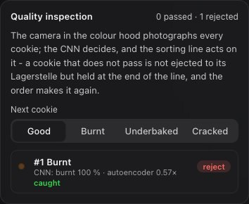

# Panel: Orders

The first panel; also opened by *New order* and *Place an order*.

## In brief

The first panel; also opened by *New order* and *Place an order*.

## New order

Pick a flavour (chocolate, strawberry, vanilla) and a quantity of 1 to 12, then *Place order*.
"N raw available" says how many moulds still hold raw dough: an order can only use raw cookies,
and the button is disabled when none are left. Orders queue; the cell works through them in
order.

*Deliver N baked cookies and refill with dough* appears once cookies are baked: it takes the baked
cookies out and refills their moulds with fresh dough, so new orders can run. It waits until the
cell is idle.

## Now

The cookie being made ("Strawberry cookie 2 of 4"), a progress bar in its flavour colour, the
current step in plain words and the time left for this cookie. *Running* or *Idle*.

## Quality inspection

The camera in the sorting line's colour hood photographs every cookie; the inspection's CNN decides,
and the sorting line acts on the decision. A cookie that passes is ejected to its Lagerstelle as
before. A cookie that does not pass - or that the CNN is unsure of ("to a person") - is not ejected:
the belt carries it to the end of the line, where it is held for the operator; its mould goes home
empty, and the order makes that cookie again from the next raw dough.

**Next cookie** gives the next cookie a fault for the inspection to catch: burnt, underbaked or
cracked (good, by default). The card counts the cookies passed and rejected, and lists the last
decisions: what the cookie really was, what the CNN saw and how sure it was, the autoencoder's score,
and whether the call was right, a catch, an escape (a fault passed) or a false reject. The method and
the measured results are in the Vision QC chapter (docs/vision/README.md).

## Orders

Every order placed this session, with its progress ("3 of 5 completed").

## Warehouse rack

The 12 slots (A1-C4) and what each holds: raw dough, a baked flavour, or empty while its mould is
out in the line. The summary line counts them ("11 raw · 1 in the oven line"). A slot whose cookie the
inspection rejected keeps its mould but no cookie ("empty (rejected)") until **Deliver** refills the
rack with dough; every other cookie is accounted for, so the moulds always number 12.
