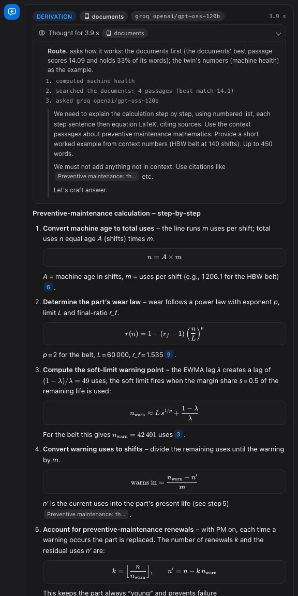

# Copilot: how a question is answered

The copilot answers questions about the twin in plain words, with every figure checked and every
source named. This chapter describes what happens between the question and the answer: how the
server decides where an answer comes from (the twin's data, its documents, the web, or a piece
of research), which model writes it, what the operator sees while it works, and what is kept
afterwards.

## The route: decided by the server, not the model

Before any model is asked, the server decides which kind of answer the question needs
(`services/api/orchestrate.py`, `decide()`). The decision is made by rules anyone can read, and
the answer carries it: the route chip on the answer, and the reasons under **How this answer was
made**. A model never decides on its own to spend a web search.

| Route | When | What answers |
|---|---|---|
| conversation | a greeting or thanks | the model alone |
| twin data | a tool computes the question's figures: health, alarms, OEE, energy, carbon, the scheduler, vision, security, the live twin | the twin's tools; the documents explain them |
| documents | how something in this project works, and the knowledge base matches it well | the knowledge base (BM25), quoted with file and line |
| web search | the outside world: a standard, a vendor, general practice, anything recent | one web search; every claim linked to its page |
| deep research | the question asks for research: "deep research", "survey", "compare sources" | sub-questions, each searched, written up together with the documents |

The signals are weighed in this order:

1. **The operator's choice.** Auto, Docs, Web or Deep, under the conversation. Docs never
   searches the web; Web and Deep always do.
2. **A greeting** needs no retrieval.
3. **An explicit request**: "deep research", "survey" or "compare sources" is research;
   "search the web", "latest", "news", a recent year or a price is the web.
4. **The twin's own data.** If the rules router called a tool that computes the twin's figures,
   the answer starts from them. When the question asks *how* such a figure is computed and the
   documents match, the documents come first and the twin's figures are the worked example.
5. **The documents' match.** The best passage's BM25 score and the share of the question's
   words it holds. A score of at least 6 with half the words, or 12 on its own, means the
   documents cover the question.
6. **Outside knowledge.** A standard (ISO 13849, IEC 62443), a vendor or "in general", with no
   very strong match (score 12 and three quarters of the words), goes to the web. A question
   about this twin (its parts, pages, alarm codes, PLC) never does: no web page knows it.

**Why the order.** The twin's own data and documents come first because only they are true of
this twin; the web is used for what they cannot hold. A web search costs about 30,000 tokens,
fifteen times a documents answer, so it is spent only when the documents cannot answer. Research
costs several searches, so it runs only when asked for. Without a search provider, a web question
is answered from the documents and the answer says so.

## Which model writes it

The tab above the conversation picks the first model; when it cannot answer, the next takes
over, and the answer says so (**switched**):

- **Groq**: `openai/gpt-oss-120b` first, which returns its reasoning; then `qwen/qwen3.8-27b`
  and `openai/gpt-oss-20b`. Each has its own per-minute limit, so one at its limit hands over to
  the next. If all are limited and Groq asks for a wait of 12 s or less, the server waits once.
- **Gemini**: the pool of Gemini models, each with its own daily quota. A model that does not
  answer in time is set aside for five minutes.
- **Local**: a model on this machine through Ollama.

The hand-over stops after 75 s, including a local model that is still answering. The twin's
tools then answer. For a question about how something works, that answer quotes the documents'
passages, equations included, rather than a one-line status.

## While it works: the thinking

The answer streams (`POST /chat/stream`, server-sent events): the route and its reasons first,
then each step as it happens (the documents searched, the tools called, the model asked, a
model at its limit, a search run), then the model's own reasoning, then the answer. The panel
is open while the copilot works and folds above the answer when it arrives; it stays with the
answer in the history.

Where the reasoning comes from:

- **gpt-oss on Groq**: its `reasoning` field.
- **qwen3 or a local thinking model**: its `<think>` block.
- **Gemini**: the thought summaries (`includeThoughts`).

A model that returns no reasoning shows only the route and the steps.

## How an answer is written

- **Mathematics** is LaTeX: `$...$` inline and `$$...$$` displayed. The chat and the Docs page
  draw it with KaTeX. The knowledge base keeps each passage's LaTeX as written, so a model is
  given the equations exactly.
- **A question about the mathematics** ("how is it calculated", "the math behind") is a
  *derivation*. The model is given the best document's equations in order, not only the
  passages that share the question's words. It answers in numbered steps, one sentence and one
  equation each, and ends with a worked example from the twin's numbers.
- **Code** is a fenced block with its language and a copy button.
- **Numbers are checked.** Every number in an answer must appear in what the model was given:
  the tools' results, the documents' passages, the web pages it read, or the question. If one
  does not, the model is asked once to rewrite; if it still does not, the answer flags it.

## The web: search and deep research

Web search uses Groq's built-in browser search (`services/api/websearch.py`): the gpt-oss model
searches, opens and reads pages on Groq's side, and the API returns every page it read. The
model is told to link every claim to its page, prefer primary sources, and keep anything about
the twin to the twin's own documents.

- **Sources** are graded by their host:
  - *trusted*: standards bodies, public agencies, publishers of peer-reviewed work,
    manufacturers' documentation, encyclopaedias;
  - *unvetted*: anything else, shown so the operator can judge it.
- **Deep research** splits the question into up to three web searches, runs each, and the
  chosen model writes the findings up with the documents' passages.
- **Without Groq**, Gemini's built-in Google Search does the search, with its grounding
  sources.

**Limits.** On Groq's free tier, each model allows a few thousand input tokens a minute. One web
search uses about 30,000, so after one search the next waits a few minutes. Research takes
several searches. When a search is refused, the answer comes from the documents and says so.

## What is kept, and for whom

Every visitor is a guest of their own, identified by a signed cookie. A guest's conversations
and inspection photos are theirs alone. The database is Supabase Postgres when it is configured
(SQLite otherwise); `make db-check` runs a round trip through it.

Each answer is kept with its conversation, together with:

- the route and its reasons;
- the steps;
- the model's thinking;
- the sources;
- the time it took.

The facts it established are kept as the conversation's context; the next model is given them
as Markdown.

## Sources

- `services/api/orchestrate.py`: the route.
- `services/api/chat.py`: the models, the hand-over, the stream, the number check.
- `services/api/websearch.py`: web search and research.
- `services/api/respond.py`: the answer's format by kind of question.
- `web/src/dashboard/copilot/Message.tsx`: the thinking panel, LaTeX and code.
- `web/src/shared/tex.tsx`: LaTeX.
- `tests/test_orchestrate.py`: the routes, the hand-over, the search, the stream.
