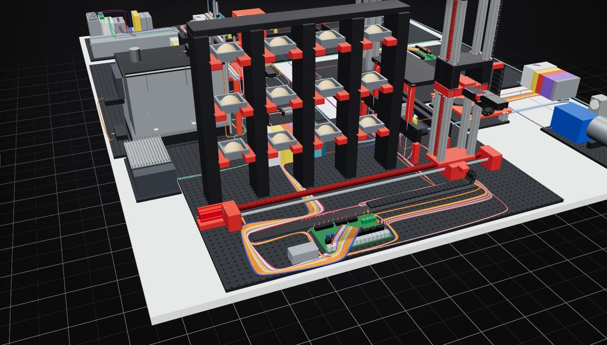
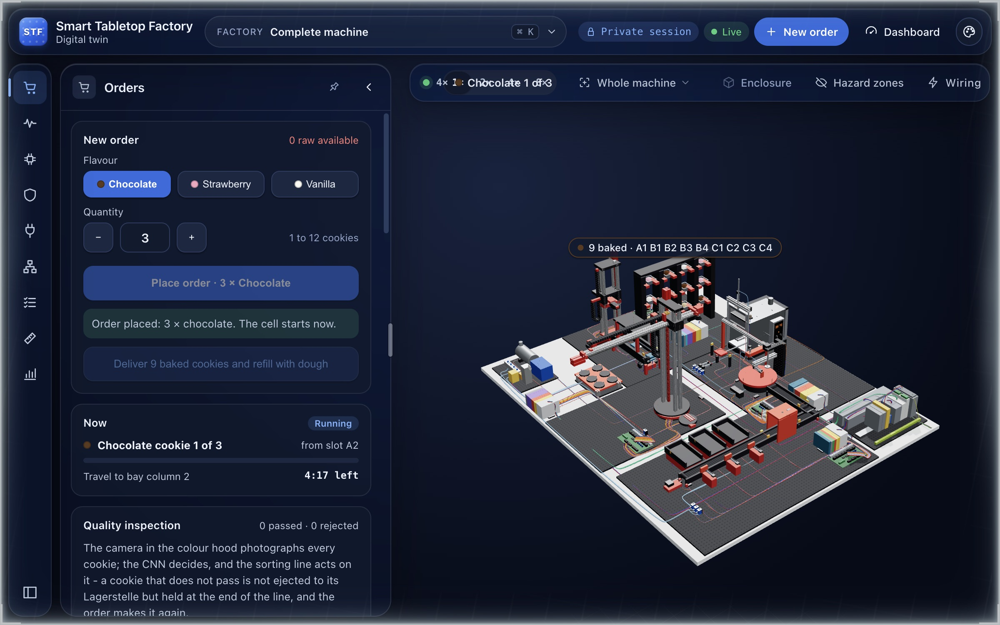
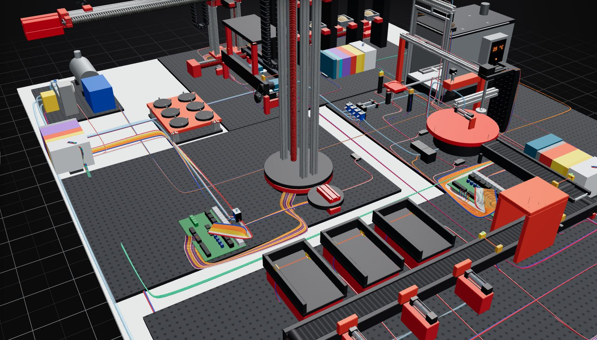
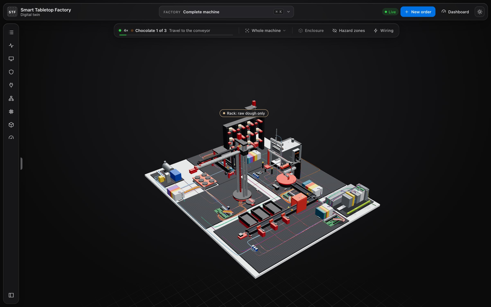
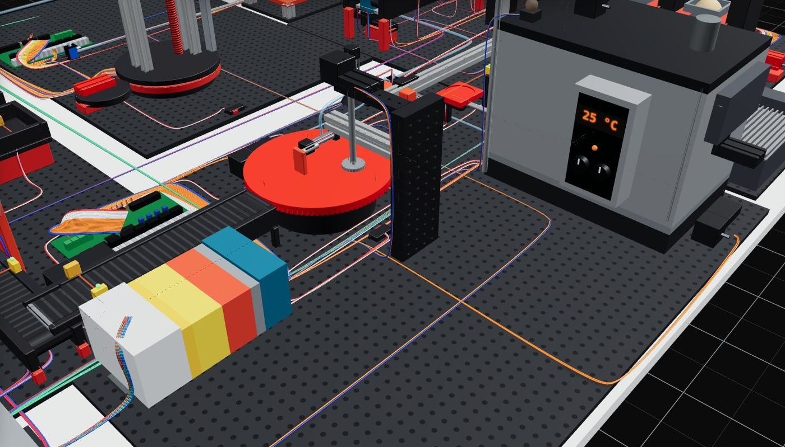
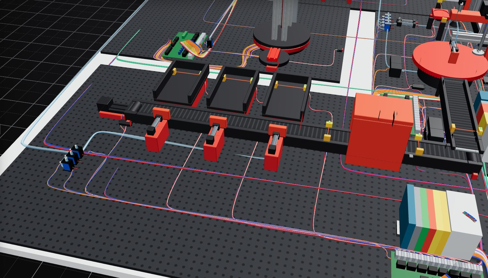

# The factory and its twin

## In brief

One production cell exists twice: as a physical fischertechnik training factory on a desk, and as an interactive 3D twin in the browser. Both are built from the same machine model, so a number read on the dashboard traces back to the same mechanism it names. This page pairs the two, module by module.

## Two views of the same machine

The renders below are the design ground truth of the physical cell — what the machine on the desk is laid out to be. The screenshots are the digital setup: the live web twin running the same mechanisms, the same PLC program and the same timing model.

## Module by module

### High-bay warehouse

The 3 × 4 rack of moulds and the stacker crane that serves it. In the twin, pick any bay from the order form or the view switcher and watch the crane's rack-and-pinion drive count each rack position.

### Vacuum gripper robot

The gantry arm that carries a mould and its cup of dough between the warehouse belt, the oven and the sorting line — the busiest mechanism in the cell.

### Multi-processing oven

The chamber with the Drehtisch (rotary table), the saw for dividing the dough, and the Ofenschieber (pusher) that slides the mould in and out. The 2 s lamp bake is the physical demo; the full baking time model lives in the twin.

### Sorting line

The belt, the colour hood with the inspection camera 40 mm before the colour sensor, three ejectors and their Lagerstellen.

### PLC cabinet

The controller the whole cell obeys. The twin runs the same program, generated from the same export the reference documents are drawn from — so the I/O names and unit sequencers you read in the docs are the ones the twin executes.

## Where the twin differs on purpose

- **Speed.** The physical demo bakes in about 2 s under a lamp so a class can watch a full order in minutes. The twin models the full bake and transfer times, and the fast-forward control (1× / 2× / 4× / 8×) lets you watch either horizon.
- **Faults.** Alarms, watchdogs and safety reactions are commissioned by injecting faults into the twin — things you would not do to the desk machine.
- **Scale.** Every number on the dashboard is computed from the twin's model (the same `up12` export), not typed in: production, health, maintenance, energy and alarms all trace to one source.
