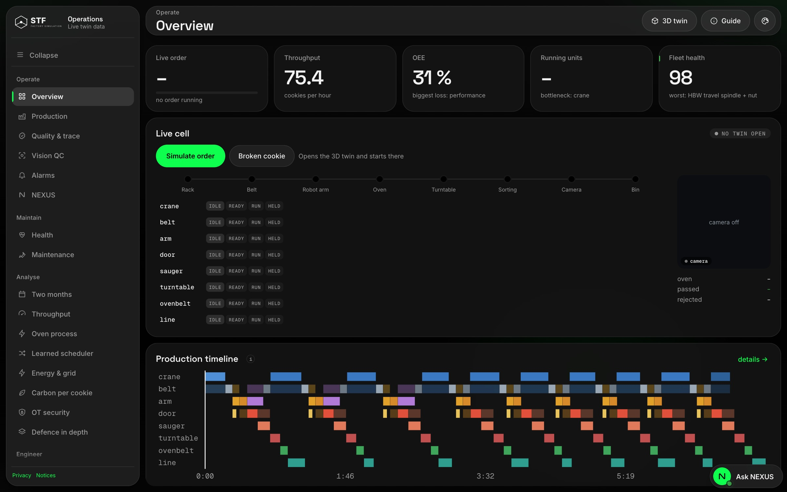
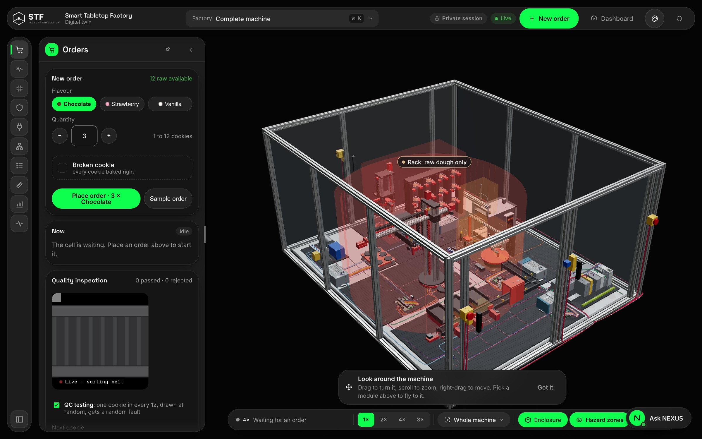
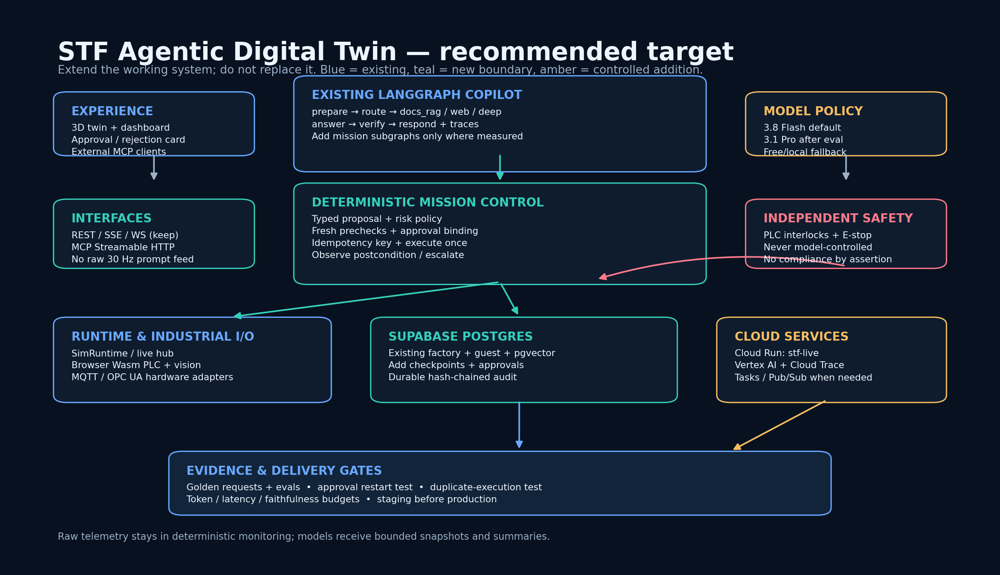
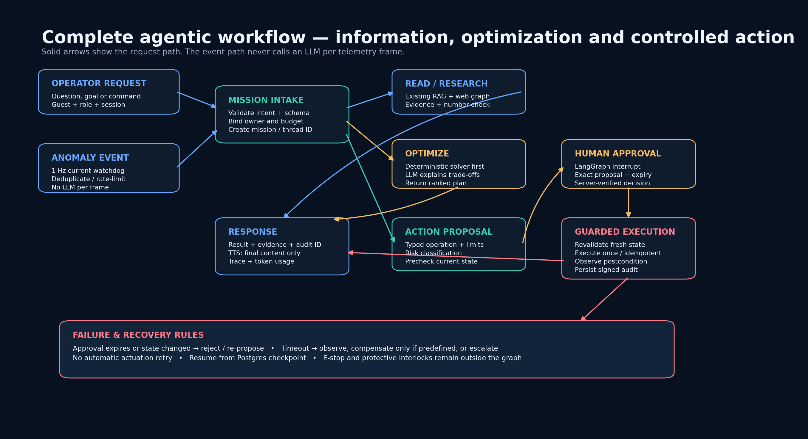
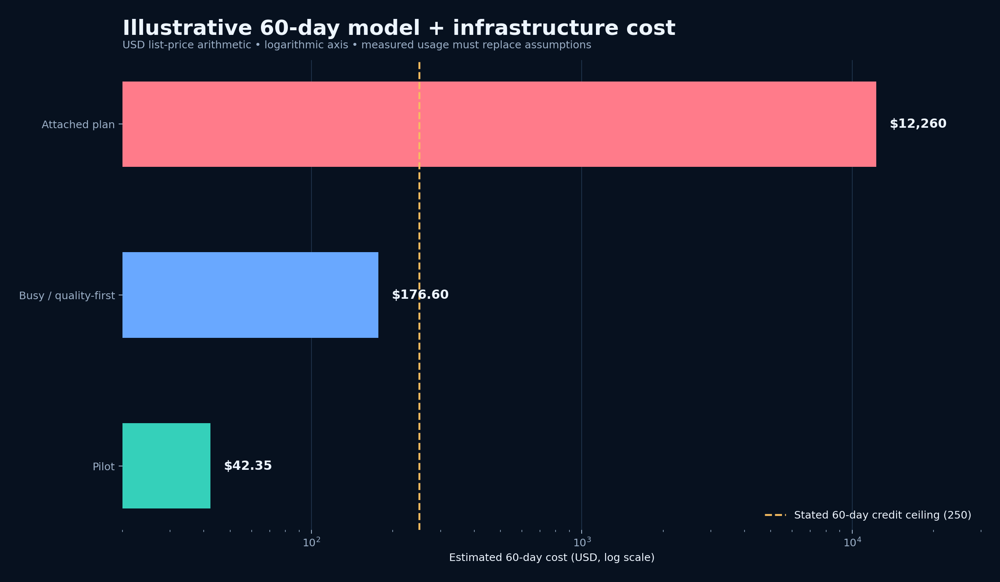
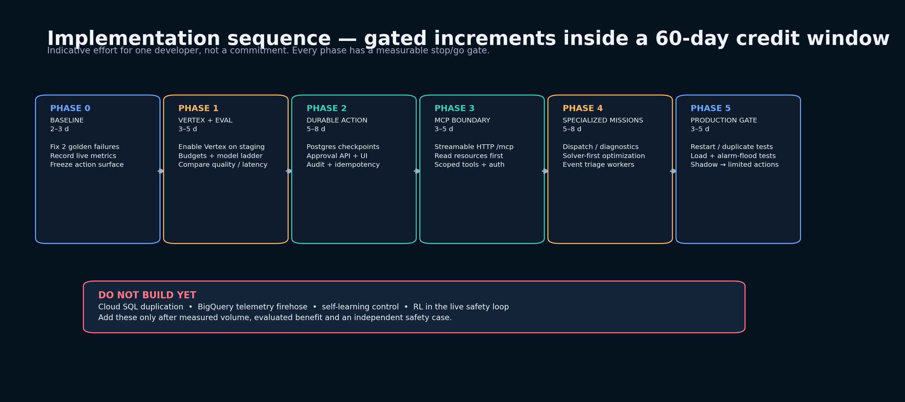

# STF agentic digital twin — feasibility and corrected implementation plan

**Assessment date:** 26 October 2026  
**Reviewed proposal:** [Advanced Industrial Agentic Architecture](../../advanced_mcp_langgraph_agentic_plan.md)  
**Scope:** architecture, current implementation, live deployment, safety controls, persistence, MCP, model routing, cloud-credit feasibility and delivery sequence  
**Assessment type:** code and configuration review, read-only live checks, backend test run and official-documentation verification. No application code, cloud configuration or production data was changed.

---

## 1. Executive verdict

**Proceed — but as a controlled extension of the existing system, not as the proposed ground-up multi-agent replacement.**

The proposal is directionally sound in four areas:

1. use LangGraph for explicit, recoverable missions;
2. put consequential actions behind durable human approval;
3. expose bounded factory capabilities through a standard MCP interface;
4. use Vertex AI for credit-eligible Gemini workloads and measured model routing.

Its central premise is nevertheless out of date: **STF is not a monolithic prompt-and-tool agent.** A LangGraph graph is already the live default, with deterministic routing, corrective document retrieval, web/deep-research branches, a provider fallback ladder, tool execution, numerical verification and tracing. The highest-value work is therefore **durable mission state and guarded execution**, not rebuilding the copilot as a hierarchy of LLMs.

### Decision summary

| Question | Finding | Decision |
|---|---|---|
| Is the architecture technically feasible? | Yes, on the current FastAPI, Cloud Run, LangGraph and Supabase foundation. | **Go, in gated phases.** |
| Is the proposed system already built? | No. LangGraph is live; hierarchical workers, MCP, checkpointing and durable approvals are not. | Treat these as future capabilities. |
| Will more agents automatically improve quality? | Not established. Extra model calls can increase cost, latency and inconsistency. | Add a specialist only when an evaluation shows a benefit. |
| Is the actuation layer production-safe? | No. Useful guards exist, but persistence, identity, execute-once behavior and independent safety evidence are incomplete. | Simulation-first; no autonomous physical control. |
| Can the stated credit fund a pilot? | Very likely at bounded pilot volumes, subject to the unverified balance, currency and expiry. | Cap usage and retain free/local fallbacks. |
| Is the attached cost model reliable? | No. Its implied model usage is orders of magnitude above its daily allocation. | Replace it with measured token and request budgets. |
| Should Cloud SQL, BigQuery and new telemetry stores be added now? | No measured need was found. | Reuse Supabase; add analytics only after volume justifies it. |

**Recommended first investment:** Phase 0 baseline repair plus Phase 1 Vertex/evaluation enablement in staging.  
**Do not start with:** autonomous control, a public write-capable MCP server, BigQuery ingestion or a supervisor that calls an LLM for every machine event.

---

## 2. What exists today

### 2.1 Current product surface

The current copilot already presents evidence, established facts, source links, response timing and multiple research modes. The corrected design should preserve these strengths and add mission status, approval cards, action outcomes and audit references without hiding existing answer evidence.



*Current copilot: document/web/deep modes, contextual facts and evidence are useful foundations for the mission interface.*

The twin already provides the natural operational surface for reviewing a proposed order or process change. Approval should show the exact parameter diff and affected asset here, while the final execution decision remains server-authorized.



*Current twin: a suitable place for a future proposal preview and approval card; this screenshot is not evidence that durable approval exists.*

### 2.2 Verified implementation baseline

| Area | Verified current condition | Evidence |
|---|---|---|
| Agent orchestration | LangGraph `1.2.16` is pinned. The graph contains prepare, route, document RAG, web/deep research, answer, verify and response behavior. It is the default engine. | [agent.py](../../services/api/agent/graph.py), [requirements-api.txt](../../requirements-api.txt), [agent-graph.md](../reference/architecture/agent-graph.md) |
| Research and retrieval | Corrective retrieval, source policy, Gemini/Groq/DuckDuckGo search lanes, literature research and deep-research planning/critic/gathering already exist. | [agent.py](../../services/api/agent/graph.py), [copilot-answers.md](../reference/copilot/answers.md) |
| Provider resilience | Existing provider ladder and cooldowns should be retained rather than replaced by a new framework-specific fallback. | [chat.py](../../services/api/agent/chat.py), [agent-graph.md](../reference/architecture/agent-graph.md) |
| Durable graph state | The graph currently calls `g.compile()` without a checkpointer. No durable mission checkpoint or stable approval thread was found. | [agent.py](../../services/api/agent/graph.py) |
| Human approval | No implemented LangGraph `interrupt()` approval flow or operator approval API/card was found. | [agent.py](../../services/api/agent/graph.py), current copilot UI |
| MCP | No FastMCP/MCP server is integrated in the current API or dependency set. | [app.py](../../services/api/app.py), [requirements-api.txt](../../requirements-api.txt) |
| Actuation guards | Typed operation checks, parameter bounds, an emergency latch, runtime submission/cancellation primitives and HMAC records exist. | [actuation.py](../../services/api/industrial/actuation.py) |
| Audit durability | Audit records and watchdog incidents are process-memory lists; they do not survive restart or provide a shared multi-instance ledger. | [actuation.py](../../services/api/industrial/actuation.py), [watchdog.py](../../services/api/industrial/watchdog.py) |
| Request authorization | `CommandGuard` provides local/operator-token authorization and command rate limiting. Live health reports `commands: localhost only`, so the public deployment does not expose normal operator commands. | [security.py](../../services/api/security/__init__.py), [app.py](../../services/api/app.py), live `/health` |
| Watchdog | Telemetry polling defaults to **1 second (1 Hz)**, with in-memory incident deduplication. It is not a 10 Hz LLM event-triage system. | [watchdog.py](../../services/api/industrial/watchdog.py) |
| Operational data | Supabase already stores guests/documents, factory month data, twin records and pgvector knowledge data; SQLite remains the local/fallback store. | [DATABASE.md](../reference/operations/database.md), [supabase/migrations](../../supabase/migrations) |
| Tracing | OpenTelemetry instrumentation exists. No OTLP exporter endpoint was present in the inspected live service specification. | [tracing.py](../../services/api/core/tracing.py), live configuration check |

### 2.3 Live deployment observed read-only

| Setting | Observed value |
|---|---|
| Project / service | `smart-tabletop-factory-512013` / `stf-live` |
| Region | `europe-west1` |
| Cloud Run resources | 1 vCPU, 1 GiB |
| Scaling | maximum 2; minimum scale not set (scale-to-zero behavior) |
| Billing/CPU mode | CPU throttling `true` — request-based processing |
| Public health | version `4.0.0`; commands `localhost only` |
| Copilot status | `engine: graph`; Gemini, Groq and UPB lanes available |
| Configured primary Gemini model | `gemini-3.5-flash` |
| `GEMINI_VERTEX_PROJECT` | **Not present** — the implemented Vertex lane is not enabled on this live revision |
| `STF_SESSION_SECRET` | **Not present in the inspected service spec** — must be resolved before relying on stable multi-instance identity |
| `STF_API_TOKEN` | Not present; consistent with public commands remaining disabled |
| OTLP traces exporter | Not present in the inspected service spec |

Vertex AI and Cloud Run APIs were previously confirmed enabled. The audit could not verify the service account's `roles/aiplatform.user` grant because IAM policy access was unavailable and the Cloud Resource Manager API was disabled. **IAM readiness remains unverified; do not infer a grant from API enablement.**

The stated **€250 over 60 days** is treated as a user-supplied planning constraint. Actual credit balance, currency, expiry and billing budgets were not readable during this review.

### 2.4 Test baseline

The backend suite was rerun with performance tests excluded:

```text
559 passed, 2 failed in 77.19 s
```

Both failures are:

```text
tests/test_golden_requests.py::test_every_provider_is_sent_the_recorded_requests[graph]
tests/test_golden_requests.py::test_every_provider_is_sent_the_recorded_requests[linear]
```

Both are Groq recorded-request mismatches. This is a **release-gate failure**, even if the fixtures are stale rather than the runtime behavior being wrong. Phase 0 must inspect the intentional protocol/prompt change, re-record or correct the fixtures deliberately, and then obtain a clean run before expanding the graph. It would be incorrect to describe the current tree as fully green.

---

## 3. Claims in the attached plan that need correction

| Attached claim | Assessment | Corrected position |
|---|---|---|
| “Traditional monolithic prompt-and-tool agent” | **Out of date.** | A live LangGraph state machine and tool loop already exist. Extend them. |
| MCP plus LangGraph gives a “generational leap” | **Unproven.** | Benefits depend on task quality, latency, faithfulness and recovery measurements. MCP is an interoperability boundary, not a reasoning improvement by itself. |
| Prompt tokens drop by approximately 70% | **Unmeasured.** | Bounded snapshots can reduce tokens, but the current system does not establish a 70% baseline. Measure input tokens per route before and after. |
| Entire 30 Hz telemetry is dumped into the prompt | **Not an accurate current-design assumption.** | Keep raw streams in deterministic monitoring regardless; send only task-relevant, time-bounded snapshots and aggregates to models. |
| Checkpointing gives zero state loss | **Too absolute.** | Postgres checkpoints improve recovery, but external side effects, retention, idempotency and database failures still require explicit handling.[^1^] |
| Resume occurs from the exact interrupted line | **Incorrect.** | On resume, the containing node restarts from its beginning. Side effects must be isolated and idempotent.[^2^] |
| `MemorySaver / Cloud SQL` is a production recovery choice | **Incorrect for restart durability.** | MemorySaver loses state on restart. Use `PostgresSaver`/`AsyncPostgresSaver`, stable thread IDs and retention.[^1^] |
| HITL makes unapproved destructive action impossible | **False guarantee.** | Approval reduces risk; it does not replace authentication, fresh-state validation, independent interlocks or execute-once design. |
| HMAC plus interrupts means strict IEC 62443 compliance | **Unsupported.** | IEC 62443 covers an IACS security lifecycle, roles, risk assessment and system/component requirements. A feature list is not certification or conformance evidence.[^9^] |
| ISO 13849 can simply be cited by the diagnostic agent | **Unsafe oversimplification.** | ISO 13849 concerns safety-related control-system design and performance levels. Keep functional safety independent of the LLM and perform a separate safety assessment.[^10^] |
| Gemini Flash performs sub-second real-time actuation | **Not a valid control design.** | Network/model latency is variable. Deterministic PLC/runtime control owns real-time behavior; an LLM may propose bounded changes outside the safety loop. |
| Watchdog runs at 10 Hz | **Incorrect.** | Current default is 1 Hz. More importantly, do not invoke an LLM per telemetry frame. |
| MCP should be mounted at `/mcp/sse` | **Legacy transport choice.** | Use authenticated Streamable HTTP at one `/mcp` endpoint; SSE may be used inside that transport. Validate `Origin`.[^3^] |
| Supervisor/worker hierarchy is the missing foundation | **Incorrect priority.** | Durable approvals, execution records and evaluation are missing first. Specialist subgraphs come later. |
| Cloud SQL is required beside Supabase | **Unnecessary initially.** | Reuse existing Supabase Postgres unless measured scaling or operational requirements prove otherwise. |
| BigQuery and WORM storage are immediate requirements | **Premature.** | Define audit retention/export first. Add object lock or analytical export when a real retention/compliance requirement exists. |
| €2/day funds about 80 Pro investigations | **Arithmetic does not support it.** | At the report's illustrative token profile, 80 investigations cost $23.68/day before infrastructure. |
| €1/day funds about 4,000 Gemini 3.5 Flash turns | **Arithmetic does not support it.** | At the illustrative profile, those turns cost $180/day. |
| The plan perfectly consumes the credit | **Not a valid engineering objective.** | Optimize verified usefulness per unit cost. Unused credit is preferable to unnecessary tokens. |

---

## 4. Current versus target capability matrix

| Capability | Current | Recommended target | Priority |
|---|---|---|---|
| Conversational copilot | Working LangGraph default | Preserve; measure each change | Keep |
| Document/web/deep research | Working multi-lane implementation | Reuse; add per-route quality/cost telemetry | Keep |
| Deterministic routing | Working rules router | Keep authorization and spending decisions outside the LLM | Keep |
| Mission orchestration | Request-scoped graph | Durable mission/thread with explicit lifecycle | **P0** |
| Human approval | Not implemented | Typed, expiring, server-verified approval bound to exact proposal | **P0** |
| Execute-once actuation | Guard primitives, no durable idempotency proof | Idempotency key, execution lease, postcondition and reconciliation | **P0** |
| Durable audit | In-memory HMAC list | Persisted hash-chained records with authenticated actor and retention | **P0** |
| MCP interoperability | Not implemented | Authenticated Streamable HTTP; read resources first | P1 |
| Specialist agents | Not implemented | Optional mission subgraphs after measured need | P2 |
| Vertex credit lane | Code exists, live lane disabled | Enable in staging, verify IAM and evaluate models | **P0** |
| Observability | Local/in-memory tracing plus OTLP support | Export metadata traces; monitor cost, quality and recovery | **P0** |
| Background anomaly work | 1 Hz deterministic watchdog | Persist/deduplicate events; queue only significant incidents for triage | P1 |
| Physical safety | Basic software latch and bounds | Independent PLC/interlock safety case; no model in safety function | Blocking for hardware |
| Cloud data platform | Supabase Postgres and pgvector | Same platform plus checkpoint/approval/audit tables | Keep |

---

## 5. Recommended target architecture



### 5.1 Design principles

**Reuse the cognitive pipeline.** The existing graph remains the entry point for questions, research and explanations. Do not replace its provider ladder or corrective RAG with a generic supervisor.

**Separate mission control from machine control.** A mission may reason for seconds or minutes. PLC/runtime control and emergency behavior remain deterministic and independent. A model never owns the real-time or safety loop.

**Use bounded context.** Raw telemetry remains in the runtime/watchdog. A mission receives a versioned snapshot containing only relevant assets, a limited time window, units, freshness and aggregates. MCP does not mean exposing an unbounded 30 Hz firehose as prompt context.

**Use deterministic solvers before LLM reasoning.** Dispatch, slot allocation, schedule feasibility, PID control and constraint checking should be code first. The model can explain trade-offs, choose among solver-valid candidates or diagnose ambiguous evidence. This is cheaper and more testable than asking it to invent combinatorial schedules or control outputs.

**Add specialists only for distinct context/tools.** A useful subgraph has a separate evaluation set and a clear boundary, for example:

- **Dispatch mission:** typed queue/inventory snapshot → deterministic optimizer → ranked plans;
- **Diagnostics mission:** deduplicated incident → relevant history/documents → cited hypotheses and checks;
- **Process optimization:** bounded process history → constraints/solver → simulated comparison, never direct self-learning control;
- **Research mission:** existing web/deep branch, not a duplicate agent.

### 5.2 MCP boundary

Introduce MCP as an **adapter over existing application services**, not as a second path around authorization or guards.

Recommended first exposure:

| MCP type | Initial examples | Access |
|---|---|---|
| Resources | bounded machine snapshot, inventory, recipe, incident, audit record by ID | Read-only, scoped by identity and freshness |
| Tools | create dispatch plan, simulate recipe change, explain incident, focus twin | Deterministic and non-actuating |
| Deferred tools | submit/cancel order, adjust recipe, acknowledge alarm, reset latch | Only after durable approval and execute-once gates pass |

Use Streamable HTTP at `/mcp`; validate `Origin`, authenticate every connection, apply scoped authorization and rate limits, and keep tool schemas small and versioned.[^3^] An external MCP client receives no implicit operator authority. Public guest access and operator access must be separate policy decisions.

---

## 6. Complete corrected workflow



### 6.1 Information and research path

1. **Authenticate and establish context.** Resolve guest/operator identity, role, session and mission/thread ID.
2. **Classify deterministically.** Select chat, twin data, documents, web, deep research or mission mode; attach token/search/time budgets.
3. **Acquire bounded evidence.** Use existing tools, corrective RAG and search lanes. Record source, freshness and units.
4. **Answer and verify.** Preserve the existing model ladder, number check, citations and final-content-only speech behavior.
5. **Record outcome.** Store metadata trace, usage, evidence references and feedback; avoid exporting content unless explicitly enabled.

### 6.2 Optimization path

1. Convert the goal into a typed mission schema with constraints and an owner.
2. Capture a versioned machine/inventory snapshot.
3. Run deterministic feasibility checks and solvers.
4. Let the model compare valid candidates or investigate ambiguous evidence.
5. Return a **proposal**, not an executed command, with predicted effects and assumptions.

### 6.3 Controlled-action path

A safe approval is a server-side transaction, not a boolean returned by a browser.

| Step | Required behavior | Failure behavior |
|---|---|---|
| 1. Propose | Create typed operation, canonical parameters, risk class, snapshot version, expiry and idempotency key. | Invalid schema or stale data → reject before display. |
| 2. Persist | Save proposal and mission checkpoint before requesting approval. | Database unavailable → no executable proposal. |
| 3. Interrupt | Pause with a JSON-safe payload and stable thread ID. | Service restart → resume from durable checkpoint.[^2^] |
| 4. Review | UI shows asset, exact old/new values, rationale, evidence, risk and expiry. | Ambiguous or changed proposal → require a new proposal. |
| 5. Decide | Authenticated server verifies role, session, proposal hash, decision and expiry. | Wrong user/role, replay or expired decision → reject. |
| 6. Revalidate | Re-read fresh state and check all preconditions immediately before execution. | State diverged → reject and re-plan; never execute the stale approval. |
| 7. Execute once | Atomically claim idempotency key/execution lease; call the same guarded runtime path. | Duplicate request/restart → return original outcome or reconcile; no blind retry. |
| 8. Observe | Check expected postcondition within a bounded timeout. | Timeout → unknown state; observe/reconcile or escalate, not automatic re-actuation. |
| 9. Audit | Persist actor, proposal, decision, pre/post hashes, result and trace IDs in one durable chain. | Audit write failure → action outcome is explicitly unresolved and investigated. |
| 10. Respond | Show executed/rejected/unknown status and audit ID; speech reads final content only. | Never report “success” merely because a tool call was sent. |

**Emergency-stop reset and protective interlocks remain outside ordinary agent autonomy.** The current `reset_emergency_stop()` clears a software latch but does not verify physical zone clearance. It must not be represented as a validated physical safety function.

---

## 7. Data, state and audit design

### 7.1 Reuse Supabase Postgres

Supabase already holds operational and vector data. Add only the tables required for durable missions:

| Data | Purpose | Essential fields/guarantees |
|---|---|---|
| LangGraph checkpoints | Resume graph threads | Stable thread ID, retention, owner binding; use supported Postgres saver |
| `agent_missions` | User-facing lifecycle | mission ID, owner, type, status, timestamps, budget, trace ID |
| `action_proposals` | Exact review object | canonical payload, payload hash, state version, risk, expiry, status |
| `action_approvals` | Server-verified decision | proposal hash, authenticated actor, role, decision, decision time |
| `action_executions` | Execute-once and reconciliation | unique idempotency key, lease, attempt/result state, postcondition |
| `actuation_audit` | Durable evidence | sequence, previous hash, record hash/HMAC, actor, proposal, result |
| `agent_incidents` | Persistent anomaly triage | fingerprint, severity, first/last seen, state, mission reference |

Use a unique constraint on the execution idempotency key. Hash chaining can detect reordering or modification of records under the application's key model, but it does not by itself provide legal non-repudiation, immutable retention or standards compliance. Secret keys must come from a managed secret store, actor identity from authenticated session/token verification, and retention/export from an explicit policy.

### 7.2 Privacy and lifecycle

- Bind checkpoints, approvals and mission records to the same owner model as conversations.
- Extend guest expiry and “forget me” deletion to mission-owned records, subject to a documented audit-retention exception where legally required.
- Keep raw questions/answers out of exported traces unless content tracing is deliberately enabled.
- Prune old checkpoints; LangGraph documentation explicitly warns about unbounded checkpoint growth.[^1^]
- For Cloud Run connections, use the appropriate Supabase pooler, TLS and conservative application pools. Supabase recommends transaction pooling for serverless functions, pool size 1 per warm instance, disabled prepared statements in transaction mode, and SSL required.[^11^]

### 7.3 Deferred infrastructure

- **Cloud SQL:** do not add a second operational Postgres without a measured availability/scaling reason.
- **BigQuery:** defer until analytical query volume or retention clearly exceeds Postgres operational needs; export summarized events rather than raw frames.
- **Redis/Memorystore:** defer unless checkpoint/queue benchmarks prove a need.
- **WORM/object lock:** implement only after retention and audit-export requirements are defined.
- **Cloud Tasks/Pub/Sub:** add when long-running anomaly/deep missions need reliable asynchronous execution beyond request-scoped Cloud Run CPU. Request-based billing allocates CPU during request processing; instance-based billing or a task/worker pattern is appropriate for durable background execution.[^7^]

---

## 8. Vertex AI and model-routing plan

### 8.1 Enable the existing lane before adding models

The code already supports Vertex authentication, but the live revision lacks `GEMINI_VERTEX_PROJECT`. Google Cloud welcome credit cannot pay for Gemini API usage in AI Studio, so using Vertex AI is the correct credit path.[^12^]

Staging prerequisites:

1. confirm actual credit balance, currency and expiry in Billing;
2. grant and verify the runtime service account's Vertex AI permission;
3. configure `GEMINI_VERTEX_PROJECT` and an intentional model ladder;
4. configure a strong `STF_SESSION_SECRET` through Secret Manager;
5. keep `STF_API_TOKEN` unset and public actuation disabled until the action gates pass;
6. configure metadata-only OTLP export and usage/cost dashboards;
7. test provider failover without exposing credentials or raw errors.

Gemini 3.8 Flash and Gemini 3.5 Flash have stable model IDs in the current lifecycle documentation; Gemini 3.1 Pro is listed as preview. Keep all model IDs configurable and re-run evaluation before changing them.[^4^][^5^]

### 8.2 Recommended routing policy

| Workload | Initial route | Escalation |
|---|---|---|
| Ordinary twin/docs chat | Gemini 3.8 Flash after quality/latency comparison | Existing free/local/provider fallback |
| Classification, extraction, formatting | Smallest model that passes the route's golden set | Flash only on failure |
| Deep research | Flash for planning/gathering; compare Flash vs Pro for synthesis | Pro only if measured faithfulness/completeness gain justifies cost |
| Dispatch/process optimization | Deterministic solver; Flash explains candidates | Pro only for genuinely ambiguous planning |
| Diagnostics | Flash with bounded incident evidence | Pro for evaluation-proven difficult root-cause cases |
| Safety decision | **No LLM route** | Deterministic interlocks and authorized human process |

Do not put an LLM in a sub-second actuation loop. Do not use reinforcement learning or online self-modification in the live control path. Any future learned scheduler should be trained/evaluated offline, versioned and promoted through shadow-mode evidence.

---

## 9. Corrected 60-day cost model

### 9.1 Assumptions

The following is **list-price arithmetic, not a usage forecast**. It uses global standard rates at or below 200K input tokens and the same illustrative token profiles throughout so the attached plan can be compared consistently.[^6^]

- Fast turn: **15,000 input + 2,500 output tokens**.
- Deep investigation: **100,000 input + 8,000 output tokens**.
- Gemini 3.8 Flash: **$0.75/M input, $3.75/M output** promotional pricing through 2026.
- Gemini 3.5 Flash: **$1.50/M input, $9.00/M output**.
- Gemini 3.1 Pro Preview: **$2.00/M input, $12.00/M output**.

Actual costs depend on cached input, reasoning tokens, retries, tool loops, search queries, region, pricing date and measured context length. Taxes, FX, egress and grounding overage are excluded. Grounding currently includes 5,000 queries/month and then lists $14 per 1,000 queries for the applicable Gemini 3/4 allowance.[^6^]

### 9.2 Unit costs

| Operation | Calculation | Cost |
|---|---|---:|
| Fast turn — 3.8 Flash | 0.015 × $0.75 + 0.0025 × $3.75 | **$0.020625** |
| Fast turn — 3.5 Flash | 0.015 × $1.50 + 0.0025 × $9.00 | **$0.045000** |
| Deep investigation — 3.8 Flash | 0.100 × $0.75 + 0.008 × $3.75 | **$0.105000** |
| Deep investigation — 3.1 Pro | 0.100 × $2.00 + 0.008 × $12.00 | **$0.296000** |

### 9.3 Scenario comparison



| Scenario | Daily model workload | Model cost / day | Model cost / 60 days | Infrastructure allowance | Total illustration |
|---|---|---:|---:|---:|---:|
| **Pilot** | 20 fast 3.8 turns + 2 deep 3.8 investigations | $0.6225 | $37.35 | $5.00 | **$42.35** |
| **Busy / quality-first** | 50 fast 3.8 turns + 5 deep Pro investigations | $2.51125 | $150.675 | $25.92 | **$176.60** |
| **Attached plan's implied volume** | 4,000 fast 3.5 turns + 80 deep Pro investigations | $203.68 | $12,220.80 | $39.00 | **$12,259.80** |

The chart uses a logarithmic axis and a numeric 250 reference line. It is **not currency-normalized**: because the stated credit is in euros and list prices here are in USD, confirm the billing currency/FX before treating the line as a real budget ceiling.

For infrastructure context, one continuously idle 1 vCPU/1 GiB request-based Cloud Run minimum instance at the listed idle rates is approximately:

```text
($0.0000025 CPU + $0.0000025 memory) × 2,592,000 s = $12.96 / 30 days
```

That is **$25.92 for 60 days before active-request usage**, not a complete deployment quote.[^7^] Scale-to-zero remains the default; enable a warm instance only during a measured shift/latency requirement.

### 9.4 Budget controls that must exist

- Per-request token, model-call, search, page-fetch and wall-clock limits.
- Daily and 60-day application budgets by route and provider.
- Paid-model circuit breaker with automatic fallback to existing free/local lanes.
- Cache repeated questions and stable document context where semantically safe.
- Alerts at 50%, 80%, 90% and 100%, with headroom for reporting delay.
- Billing export or daily manual reconciliation during the pilot.

An alerts-only budget does **not** cap usage or spending; it only notifies and can trigger separately configured automation.[^13^] Cloud Run spend-cap support can help for covered Cloud Run resources, but it does not replace application-level Vertex token/search limits.

---

## 10. Phased implementation roadmap



**Indicative effort:** approximately **21–33 developer-days** for one developer with the existing foundation. This is a planning range, not a commitment; hardware safety assessment, external review and production certification are excluded.

### Phase 0 — baseline and freeze (2–3 days)

**Work**

- Inspect and intentionally fix/re-record the two Groq golden fixtures.
- Record per-route quality, token, latency, search and failure baselines.
- Freeze public actuation and document the current command authorization boundary.
- Confirm credit balance/expiry and staging IAM prerequisites.

**Exit gate**

- Backend suite is clean; graph/linear parity is preserved.
- Baseline report exists for representative chat, docs, web, deep and twin requests.
- No unreviewed write-capable agent path is exposed.

### Phase 1 — Vertex and evaluation (3–5 days)

**Work**

- Enable Vertex in staging and verify the runtime identity end to end.
- Compare 3.5 Flash, 3.8 Flash and Pro only on appropriate task sets.
- Add per-route usage/cost telemetry and paid-model circuit breakers.
- Configure metadata-only trace export and budget alerts.

**Exit gate**

- Vertex works without breaking fallback.
- Quality/faithfulness does not regress; latency and cost have measured budgets.
- Model IDs and rollback are configuration-driven.

### Phase 2 — durable mission and guarded action (5–8 days)

**Work**

- Add Supabase `AsyncPostgresSaver`/`PostgresSaver`, stable threads and retention.
- Implement proposal, approval, execution and audit tables.
- Add typed `interrupt()` approval, approval API and twin/copilot approval card.
- Bind approval to exact canonical payload, authenticated actor, role and expiry.
- Add fresh-state revalidation, idempotency, postcondition and reconciliation.
- Replace the default audit secret behavior with mandatory managed secrets outside development.

**Exit gate**

- Approval survives process restart and resumes on the same thread.
- Duplicate/replayed approval and execution requests cause no second action.
- Changed state, changed payload, expired approval and wrong actor all fail closed.
- Timeout produces `unknown/reconcile`, never blind retry or false success.
- Guest deletion and checkpoint retention behave as documented.

### Phase 3 — MCP interoperability boundary (3–5 days)

**Work**

- Add authenticated Streamable HTTP `/mcp` with `Origin` validation.
- Expose bounded read resources and deterministic planning/simulation tools first.
- Reuse existing application authorization and service functions; no guard bypass.
- Add client contract tests, scoped tokens and rate limits.

**Exit gate**

- An external client can discover/read only authorized resources.
- Guest/operator scopes are tested; no unauthenticated actuation exists.
- Payload size, freshness and schema versions are explicit.

### Phase 4 — specialized mission subgraphs (5–8 days)

**Work**

- Build dispatch and diagnostics subgraphs only where Phase 1 baselines show need.
- Use deterministic solvers first and bounded snapshots.
- Persist/deduplicate anomaly events; queue significant events for asynchronous triage.
- Compare single-graph vs specialist quality, latency and cost.

**Exit gate**

- Each specialist beats the simpler route on its held-out evaluation set.
- Alarm floods cannot create unbounded model calls.
- Solver constraints and no-actuation defaults hold under adversarial tests.

### Phase 5 — production gate (3–5 days)

**Work**

- Restart, duplicate-delivery, stale-approval and database-outage tests.
- Load, concurrency, connection-pool and alarm-flood tests.
- Shadow mode, read-only production validation, then tightly scoped simulation actions.
- Independent hardware/safety review before any physical connection.

**Exit gate**

- Recovery and audit evidence are complete.
- SLOs and rollback pass; public read-only behavior remains available on failure.
- Physical actuation remains disabled unless a separate safety case explicitly authorizes it.

---

## 11. Acceptance metrics

Replace the proposal's absolute claims with measured targets agreed during Phase 0. Candidate measures:

| Dimension | Measurement |
|---|---|
| Answer quality | Held-out faithfulness, correctness, citation support and unsupported-number rate |
| Task quality | Dispatch feasibility/optimality, diagnostic top-k accuracy, simulated process improvement |
| Context efficiency | Input/output tokens by route and mission; compare against current baseline |
| Latency | p50/p95 by route; separate model time, retrieval, solver and execution |
| Recovery | Successful resume after forced restart; zero duplicate side effects |
| Approval integrity | Wrong actor, replay, stale state, modified payload and expiry tests |
| Audit | Complete proposal→decision→execution→postcondition linkage |
| Reliability | Provider failover, database outage, timeout reconciliation and alarm-flood behavior |
| Cost | USD/day and cost per accepted answer/mission, with free fallback rate |
| Safety | Independent interlock tests; no model dependency in protective functions |

No “70% token reduction,” “zero state loss,” “sub-second autonomy” or “compliant” label should be published until its exact scope and evidence are available.

---

## 12. Final go/no-go checklist

### Go now

- [x] Keep the existing LangGraph copilot and provider/search ladder.
- [x] Repair the golden-test gate and capture baselines.
- [x] Enable and evaluate Vertex AI in staging.
- [x] Design Supabase-backed mission/approval/execution/audit persistence.
- [x] Build approval-first simulation workflows.
- [x] Add read-only/planning MCP after the persistence contract is stable.

### Hold until evidence passes

- [ ] Specialist supervisor/worker routes without a measured quality benefit.
- [ ] Public or externally accessible actuation tools.
- [ ] Long-running background agent work on request-based CPU without a task/worker design.
- [ ] Warm Cloud Run instances outside measured shifts.
- [ ] BigQuery, Cloud SQL, Redis or WORM infrastructure without a requirement.
- [ ] Claims of IEC 62443/ISO 13849 conformance.

### No-go for this project stage

- [ ] Autonomous emergency-stop reset or safety-interlock control.
- [ ] LLM/RL directly inside a real-time physical safety loop.
- [ ] Automatic actuation retry after an uncertain timeout.
- [ ] “Use all credits” as a success criterion.

## Final recommendation

**The plan is feasible after correction, and the current setup is a strong base.** The shortest responsible path is not “more agents everywhere”; it is:

```text
clean baseline → staging Vertex + evaluations → durable approvals and execute-once actions
→ read-only MCP → measured specialist missions → gated production promotion
```

This preserves the working copilot, uses cloud credit where it has measurable value, and creates the evidence needed before any controlled action—especially physical action—is allowed.

[^1^]: LangGraph, “Persistence” — checkpointers, thread-scoped state, production Postgres persistence, MemorySaver restart limitation and checkpoint retention. https://docs.langchain.com/oss/python/langgraph/persistence
[^2^]: LangGraph, “Interrupts” — durable checkpointer and thread ID requirements; node restart and idempotent side-effect rules. https://docs.langchain.com/oss/python/langgraph/interrupts
[^3^]: Model Context Protocol, “Transports,” specification 2025-06-18 — Streamable HTTP, `/mcp` endpoint pattern, Origin validation and legacy HTTP+SSE compatibility. https://modelcontextprotocol.io/specification/2025-06-18/basic/transports
[^4^]: Google Cloud, “Google models” — current stable and preview Gemini model catalog. https://cloud.google.com/vertex-ai/generative-ai/docs/models
[^5^]: Google Cloud, “Model versions and lifecycle” — exact model IDs and lifecycle status. https://cloud.google.com/vertex-ai/generative-ai/docs/learn/model-versions
[^6^]: Google Cloud, “Gemini Enterprise Agent Platform pricing” — Gemini token and grounding prices used on 26 October 2026. https://cloud.google.com/vertex-ai/generative-ai/pricing
[^7^]: Google Cloud, “Cloud Run pricing” and “Billing settings for services” — request/idle rates, billable instance time and background CPU behavior. https://cloud.google.com/run/pricing and https://cloud.google.com/run/docs/configuring/cpu-allocation
[^8^]: Google Cloud, “Model versions and lifecycle” — model IDs must remain configurable as lifecycle and replacements change. https://cloud.google.com/vertex-ai/generative-ai/docs/learn/model-versions
[^9^]: ISA, “ISA/IEC 62443 Series of Standards” — IACS cybersecurity requirements, lifecycle, risk assessment and certification scope. https://www.isa.org/standards-and-publications/isa-standards/isa-iec-62443-series-of-standards
[^10^]: ISO, “ISO 13849-1:2015” — safety-related parts of control systems and performance-level scope. https://www.iso.org/standard/69883.html
[^11^]: Supabase, “Connecting to Postgres” — serverless pooler selection, pool sizing, prepared-statement and TLS guidance. https://supabase.com/docs/guides/database/connecting-to-postgres
[^12^]: Google Cloud, “Free Cloud features and trial offers” — welcome-credit restrictions, including AI Studio Gemini API exclusion. https://cloud.google.com/free/docs/free-cloud-features
[^13^]: Google Cloud, “Create, edit, or delete budgets and budget alerts” — alerts-only budgets do not automatically cap usage or spending. https://cloud.google.com/billing/docs/how-to/budgets
