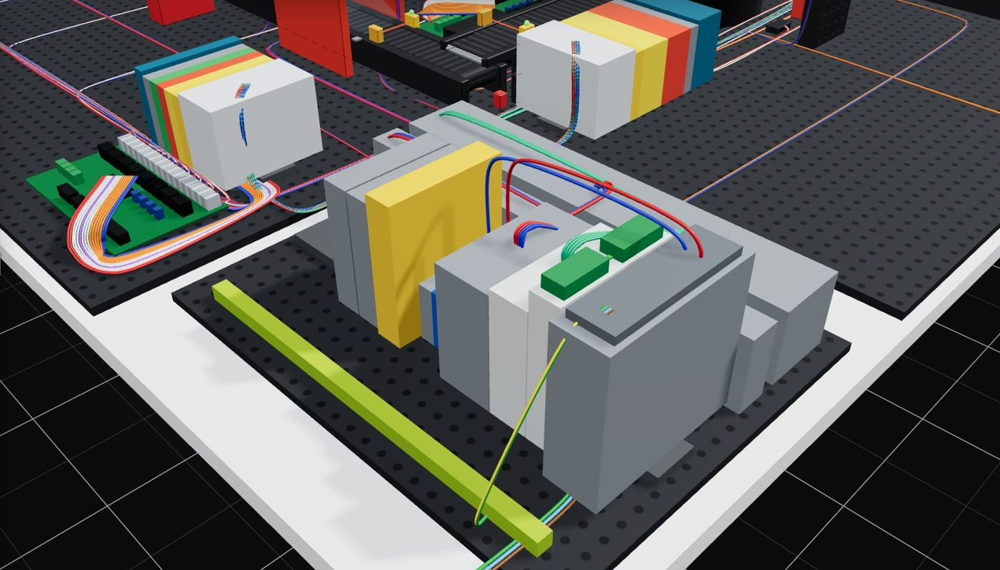

# PLC hardware and wiring

The control cabinet holds one controller and the safety circuit; each module has its own
remote I/O node on its plate, reached over Ethernet (Modbus TCP). The modules keep their
fischertechnik 24 V sensors and actuators, wired to the node through the adaptor PCB.



```plc-hardware
```

## Cabinet

| Part | What it is |
|---|---|
| din_rail | TS35 x 7.5 top-hat rail, 355 mm |
| psu_wdr120 | Mean Well WDR-120-24: 24 V / 5 A |
| revpi_core_3 | RevPi Core 3 - Modbus TCP master for the four remote I/O nodes |
| eth_switch | 5-port unmanaged industrial Ethernet switch: 4 nodes + controller (assumed size) |
| ecb_4ch | 4-channel electronic circuit breaker: one fused, monitored 24 V feed per module (assumed size) |
| terminal_1 | feed-through terminal: sensor +24 V / actuator +24 V (via K1/K2) / 0 V |
| terminal_2 | feed-through terminal: sensor +24 V / actuator +24 V (via K1/K2) / 0 V |
| terminal_3 | feed-through terminal: sensor +24 V / actuator +24 V (via K1/K2) / 0 V |
| terminal_4 | feed-through terminal: sensor +24 V / actuator +24 V (via K1/K2) / 0 V |
| terminal_5 | feed-through terminal: sensor +24 V / actuator +24 V (via K1/K2) / 0 V |
| terminal_6 | feed-through terminal: sensor +24 V / actuator +24 V (via K1/K2) / 0 V |
| safety_relay_K0 | safety relay, 2-channel, monitored manual reset, EDM input (Upgrade 2) |
| contactor_K1 | force-guided contactor K1 (Upgrade 2) |
| contactor_K2 | force-guided contactor K2 (Upgrade 2) |
| pe_busbar | PE busbar, its own bar (EN 60204-1 5.2 / 8.2): every PE conductor lands here, not on the rail |
| duct_power | power duct: mains, 24 V feeds, PE - separated from signal wiring (EN 60204-1 13.1) |
| cable_duct | signal duct: Ethernet to the four nodes, safety circuit, controller I/O |


*Sources: `web/public/hbw_parts_up12.json (plc.parts)`.*

## Remote I/O nodes

One node per module, so a module's cable run is short and a module can be replaced alone.
Slice sizes: 750-series-like, ASSUMED: coupler 51x100x72, slice 12x100x68. Every node keeps at least 20 % spare channels.

| Module | Mounted | Slices | Channels used |
|---|---|---|---|
| high-bay warehouse | own plate | DI1 (DI) DI2 (DI) DO1 (DO) DO2 (DO) CNT1 (CNT) CNT2 (CNT) CNT3 (CNT) IOL1 (IOL) | 20 of 39 |
| vacuum gripper robot | table, off every other plate | DI1 (DI) DO1 (DO) DO2 (DO) CNT1 (CNT) CNT2 (CNT) CNT3 (CNT) CNT4 (CNT) | 15 of 28 |
| multi-processing oven | own plate | DI1 (DI) DI2 (DI) DI3 (DI) DO1 (DO) DO2 (DO) DO3 (DO) | 28 of 48 |
| sorting line | own plate | DI1 (DI) DO1 (DO) AI1 (AI) | 11 of 18 |


*Sources: `web/public/hbw_parts_up12.json (io3)`.*

## Electrical conventions (24 V)

- **Inputs**: P-lesend / sinking input: the sensor switches +24 V onto the input.
- **Outputs**: P-schaltend / sourcing output: the PLC switches +24 V to the load, load to GND.
- **Reversible motors** are switched by relay pairs on the adaptor PCB (R1-R8): one output per
  direction; the program never drives both directions of one motor (a proof, chapter 7).
- **The original machine**: supply 24 V / 4.8 A, 26 digital inputs,
  10 counter inputs (5 encoders), 1 analogue input,
  35 outputs.

## The adaptor PCB

| Block | Function |
|---|---|
| ST1 | pin header to the model (ribbon cable) |
| ST2 | pin header to the model (ribbon cable) |
| ST3 | 17x2 pin header to the PLC (34 pins) |
| terminals | terminals 1-30 to the PLC (alternative to ST3) |
| R1-R8 | relays, 4 pairs, for reversing bidirectional motors |
| V1-V4 | terminals for the solenoid valves |

## Where the documents disagree

The extended description and the datasheets do not always agree; the model follows the
datasheet and flags the difference:

| What | One document | The other | What to do |
|---|---|---|---|
| Colour sensor output range | 0-10 V analogue (this document p.21, p.25, p.36) | 0-2 V / 0-2000 mV (colour sensor datasheet 128599) | scale the analogue input for the range the sensor really delivers; measure it on the machine |
| Warehouse vertical motor outputs | 'Q6/Q7 (M3)' on the wiring page (p.10) | Q5/Q6 on the pin header (p.9), the Belegungsplan and terminals 21/22 | typo on p.10 - Q5/Q6 is used here |
| Processing station valve V2 | 'Vakuum / vacuum' in the board table (p.4) | Q12 'Ventil Senken / valve lowering' on terminal V2 (p.18, Belegungsplan) | V2 = lowering is used here (it is wired to Q12) |
| Sorting line terminal 9 | labelled 'I4' on the pin header (p.24) | A4, the analogue colour sensor, on the wiring page (p.25) and Belegungsplan | an analogue signal on a pin the header calls digital - the RevPi DIO occupancy plan lists the colour sensor as 'not used' |
| Oven turntable Q1 direction | English 'counterclockwise' for BOTH Q1 and Q2 (Belegungsplan) | German 'im Uhrzeigersinn' (clockwise) for Q1 | Q1 = clockwise is used here |


*Sources: `web/public/controller.json`; `536634-Factory-simulation-24V-extended-description.pdf`.*

*Generated from the twin's exports by `docs/gen/plc_docs.py`; do not edit.*
