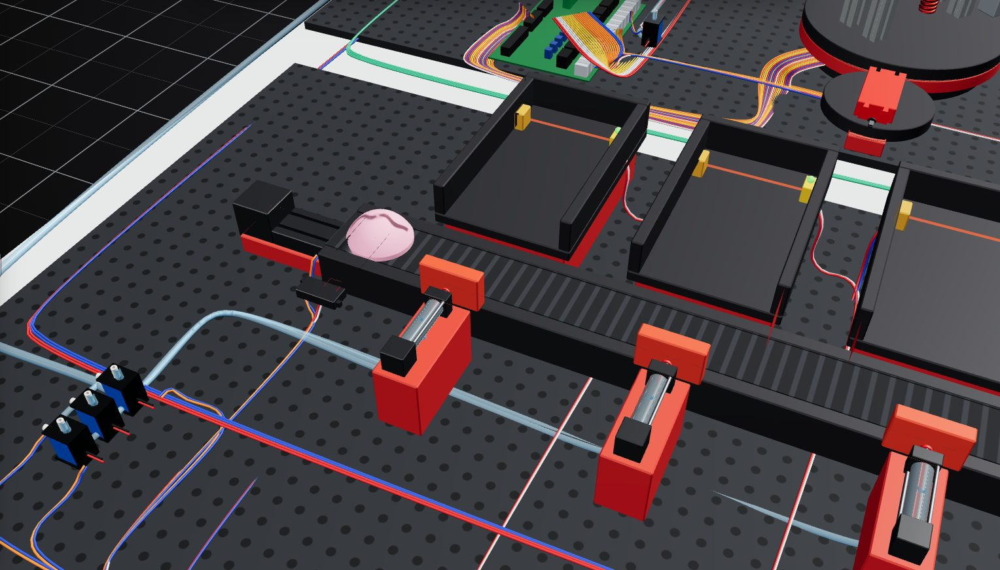
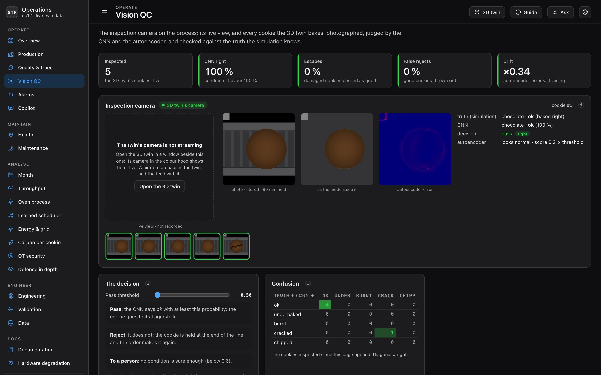
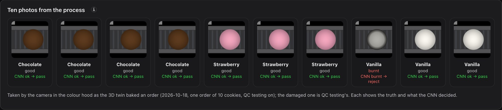

# Vision QC: the inspection camera and its models

A camera in the sorting line's colour hood photographs every cookie. A convolutional network
decides whether it is good, an autoencoder checks that it looks like the cookies the network was
trained on, and the sorting line acts on the decision: a cookie that does not pass is not ejected
to its Lagerstelle but held at the end of the line, and the order makes it again. The camera
sees, the network decides, the machine does what it decided: physical AI on a small scale.

## The loop, step by step

1. **Trigger.** The cookie crosses the lens's axis on the sorting belt; the cell takes one photo
   (`web/src/scene/engine/CellCoordinator.ts`, `camera()`: a change of side between two ticks, so
   fast playback cannot step over it).
2. **Photo.** The twin renders the camera's view off screen and, at the same instant, the empty
   hood: the reference image (`web/src/vision/photo.ts`, `expose()`).
3. **Preparation.** The cookie is found against the reference image; everything that is not cookie
   is set to the belt's own colour; the grey reference target is kept
   (`web/src/vision/twinCamera.ts`, `prepare()`).
4. **Decision.** The CNN gives the condition, the autoencoder the anomaly score
   (`web/src/vision/inspect.ts`, `judge()`), in the browser, in a few milliseconds.
5. **Action.** The verdict reaches the cell before the cookie reaches the first ejector (about 4 s
   of belt at 60 mm/s). On *pass* it is ejected to its Lagerstelle as before; on *reject* (or
   *to a person*, when the network is unsure) no ejector fires, the belt carries it to the end of
   the line, the robot finds its bay empty, its mould goes home empty, and the order starts that
   cookie again from the next raw dough (`CellCoordinator.ts`, `complete()`; `OvenFlow.ts`,
   `buildFlow(..., reject)`).

The two journeys are the same, at the same speed, up to the ejectors, so the cell can switch a
cookie to the reject path the moment the verdict comes in. The reject path needs no hardware the
CAD model does not have: the belt simply runs on to its end.

## Trying it

In the 3D twin, open **Orders** and place an order. **QC testing** is on by default: in every 12
cookies one, drawn at random, is burnt, underbaked or cracked, so every rack tests the inspection.
Under **Quality inspection** you can also choose a fault for the next cookie yourself. Watch the
damaged cookie pass the camera, skip its ejector and stop at the end of the line. The card lists each decision: what the cookie really was,
what the CNN saw and how sure it was, the autoencoder's score, and whether the call was right, a
catch, an escape or a false reject.

The dashboard's **Vision QC** page shows the same camera live (streamed while the page is open,
never stored), each photo next to the image the models were given and the autoencoder's error
map, the confusion matrix of the cookies inspected since the page opened, and ten sample photos
from the process.

## The camera

| What | Value | Source |
|---|---|---|
| Mount | hood roof, 40 mm before the colour sensor A4 | `stf-cad/hbw/vision/mount.py` |
| Field | 80 mm square at the belt, 64 x 64 px for the models (1.25 mm per px) | `web/public/vision/camera.json` |
| Projection | top view, telecentric (orthographic) | `web/src/vision/photo.ts` |
| Light | six LEDs on a 20 mm ring around the lens, 23 degrees off the axis | `web/src/scene/SortingModule.tsx` |
| Reference | a 50 % grey target, 7.5 mm square, in the image's top-left corner | `stf-cad/hbw/vision/render.py` |

### Why a telecentric view

`mount.py`'s 80.8 degree lens frames 80 mm at the **belt**. The cookie's top is 20 mm nearer the
lens, where the same lens sees only about 46 mm: the cookie would fill the frame. The models were
trained on 45 mm cookies in an 80 mm field. The first photos the twin took were judged *chipped*,
every one, with the autoencoder at 25 times its threshold. A telecentric lens images the cookie at
its true size at any height; this is the view the training images assume, and the one the twin
renders. The mount's lens angle is noted as a finding for the CAD model, not changed here.

### Bringing the twin's images into the training domain

Each step was measured on the twin's own photos (the CNN's verdict, the autoencoder's score in
multiples of its threshold):

| Change | Effect |
|---|---|
| Telecentric 80 mm field, only the hood lit | the whole cookie in view at 36 px, as in training |
| The grey reference target in its corner | the networks divide the light out by it: without it the autoencoder's score ran to 10^6 |
| The belt in the CAD's rubber (#1f2023) | the twin's lighter belt had read as the training's "worn belt" shift |
| A domed cookie, its profile the cosine of render.py's shading (k = 0.3) | a flat top was called *chipped* by the CNN |
| A matte cookie, no specular | a white veil raised the blue channel: chocolate read as strawberry |
| The rails and walls set to the belt's colour (the empty-hood reference) | the rails' bright bands were called *chipped*: with them masked, every flavour is *ok* |

After these, the twin's good cookies pass as their own flavour, *ok* at 100 %, with the
autoencoder at 0.2-0.35 times its threshold.

## The CNN

| | |
|---|---|
| Layers | four 3 x 3 convolutions, 16-32-64-64 channels, batch norm folded into the weights, ReLU, 2 x 2 max-pool after the first three, global average pooling, a 64-unit layer, two heads |
| Heads | flavour (chocolate, strawberry, vanilla) and condition (ok, underbaked, burnt, cracked, chipped) |
| Parameters | 65,192 |
| Input | 64 x 64 x 3, divided by the grey target's reading (light level and colour) |
| Training data | 24,000 images rendered with domain randomisation (`render.py`): position, rotation, size, light level and colour, dome shading, belt texture, sensor noise, focus |
| Decision | pass only if the condition head says *ok* with p >= 0.5; if no class reaches 0.6 the cookie goes to a person |
| Deployed as | ONNX (max abs error 6e-6 against PyTorch) and JSON weights for the browser (max abs error 3e-5) |

**On the process.** The ten sample photos in the dashboard (an order of ten, QC testing on):
every one decided right, the burnt cookie caught. *Source: `web/public/vision/samples/samples.json`.*

## The autoencoder

A convolutional autoencoder (26,363 parameters, an 8 x 8 x 8 bottleneck) trained on good cookies
only: it never saw a defect and needs no labels. A cookie's **anomaly score** is the worst 6 x 6
px patch of its reconstruction error; the threshold is the 99th percentile of good cookies. The
**drift** signal is the mean error of good-looking cookies against its training baseline: above
twice the baseline, the line no longer looks like training, the cue to collect images and
retrain. *Source: `web/public/vision/autoencoder.json`, `stf-cad/hbw/vision/autoencoder.py`.*

## Measured in the twin

The closed loop, run in the 3D twin with a fault injected into one cookie of each flavour (the
replacements are the good ones):

| Cookie | CNN | Autoencoder | Decision | Outcome |
|---|---|---|---|---|
| chocolate, burnt | burnt 100 % | 0.54 x | reject | caught; held at the end of the line |
| chocolate, good | ok 100 % | 0.21 x | pass | right |
| strawberry, cracked | cracked 100 % | 2.71 x | reject | caught; held at the end of the line |
| strawberry, good | ok 100 % | 0.29 x | pass | right |
| vanilla, underbaked | underbaked 99 % | 0.47 x | reject | caught; held at the end of the line |
| vanilla, good | ok 100 % | 0.35 x | pass | right |

## The faults, as the simulation draws them

The 3D cookie carries its fault as its dome's texture, drawn to `render.py`'s definitions:
**burnt** - colour times 0.45, the rim darkened from 60-75 % of the radius out; **underbaked** -
only 30 % of the bake's colour; **cracked** - a wavy dark line across the top, 1-2 px wide in the
camera's image and 60-95 % of the radius long. The dome's UVs are polar, so a radius and an angle
map straight onto the texture (`web/src/scene/parts.tsx`, `faultMap()`). *Chipped* is not drawn:
it would need a cut in the cookie's mesh.

## Limits

- Everything is rendered: the models, the camera and the faults. This shows the method and the
  deployment path, not the accuracy on a real camera.
- The masking of the hood's rails and walls uses a reference image of the empty hood at the same
  instant; a real station keeps a calibration image and must update it as the belt wears.
- A rejected cookie is held, not discarded: the operator removes it. Its slot's mould stays empty
  until the rack is refilled (**Deliver** in the Orders panel).
